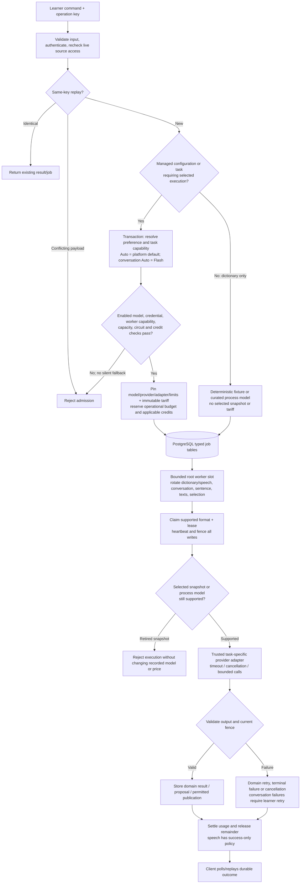

# AI job lifecycle and accounting

Managed admission pins model and price; dictionary fixture mode and bounded execution have explicit branches.

The queue is PostgreSQL, not Redis. Separate typed job stores preserve domain
lifecycles while capacity and numerical usage are coordinated across domains.
A root worker slot tries domains sequentially and rotates its starting domain;
shared speech and dictionary generation alternate within coordinator turns. Extra domains do not create
independent unbounded worker pools.

The managed path shown pins execution and tariffs. When no managed configuration
exists, non-explicit dictionary work can use the active deterministic-development
or curated process-model route with a null selection snapshot; this is retained
current behavior, not an obsolete arbitrary endpoint fallback. Conversation,
sentence and texts admission require selection. Credit enforcement is an explicit
configuration gate.

Explicit selection fails if incompatible or unavailable. Managed admissions pin
their execution; retries do not resolve today's mutable preference or tariff. Historical
configuration is meaningful for supported admitted work. Translation v2 pins its
larger reviewed Flash profile while preserving aggregate token/cost reservations.
Format allowlists and worker observations are real gates, not proof a provider is
currently reachable. ADR-0038 retires DeepSeek Chat and arbitrary legacy environment model routes.
Retired snapshots fail closed without being rewritten as Flash; historical ledgers
and terminal job identities remain truthful. Mutable defaults/preferences pointing
at a retired model require an explicit supported selection. Other versioned job
formats remain supported where admitted by current configuration.

Text usage may consume an estimated reservation after ambiguous provider cost;
provider-free failures release it. [Speech pricing](speech-and-pricing.md) settles
only after usable publication. [Conversation execution](conversations-and-knowledge.md)
accounts for answer and memory calls and avoids automatic ambiguous redispatch.
ADR-0040 removes the former owner-scoped audio worker; it does not add another
slot pool or remove current shared-speech accounting.

## Sources

- [apps/backend/src/modules/text-ai/infrastructure/persistence/drizzle/text-ai-admission-participant.ts](../../apps/backend/src/modules/text-ai/infrastructure/persistence/drizzle/text-ai-admission-participant.ts)
- [apps/backend/src/modules/text-ai/application/text-ai-provider-catalog.ts](../../apps/backend/src/modules/text-ai/application/text-ai-provider-catalog.ts)
- [apps/backend/src/modules/ai-credits/application/ai-credit-participant.ts](../../apps/backend/src/modules/ai-credits/application/ai-credit-participant.ts)
- [apps/backend/src/infrastructure/worker/dictionary-worker-runtime.ts](../../apps/backend/src/infrastructure/worker/dictionary-worker-runtime.ts)
- [apps/backend/src/infrastructure/worker/dictionary-worker-command.ts](../../apps/backend/src/infrastructure/worker/dictionary-worker-command.ts)
- [apps/backend/src/modules/dictionaries/application/dictionary-generation-service.ts](../../apps/backend/src/modules/dictionaries/application/dictionary-generation-service.ts)
- [apps/backend/src/modules/learning/application/sentence-worker-service.ts](../../apps/backend/src/modules/learning/application/sentence-worker-service.ts)
- [docs/adr/0012-dictionary-worker-and-document-ingestion.md](../../docs/adr/0012-dictionary-worker-and-document-ingestion.md)
- [docs/adr/0022-ai-credit-ledger-and-generation-settlement.md](../../docs/adr/0022-ai-credit-ledger-and-generation-settlement.md)
- [docs/adr/0026-shared-text-ai-selection-and-user-preferences.md](../../docs/adr/0026-shared-text-ai-selection-and-user-preferences.md)
- [docs/adr/0027-typed-sentence-work-and-shared-ai-accounting.md](../../docs/adr/0027-typed-sentence-work-and-shared-ai-accounting.md)
- [docs/adr/0036-task-specific-text-translation-capacity.md](../../docs/adr/0036-task-specific-text-translation-capacity.md)
- [docs/adr/0037-independent-knowledge-and-agent-proposals.md](../../docs/adr/0037-independent-knowledge-and-agent-proposals.md)
- [docs/adr/0038-preproduction-text-model-retirement.md](../../docs/adr/0038-preproduction-text-model-retirement.md)
- [apps/backend/src/infrastructure/worker/dictionary-worker-environment.ts](../../apps/backend/src/infrastructure/worker/dictionary-worker-environment.ts)
- [docs/adr/0040-preproduction-owner-scoped-audio-retirement.md](../../docs/adr/0040-preproduction-owner-scoped-audio-retirement.md)
