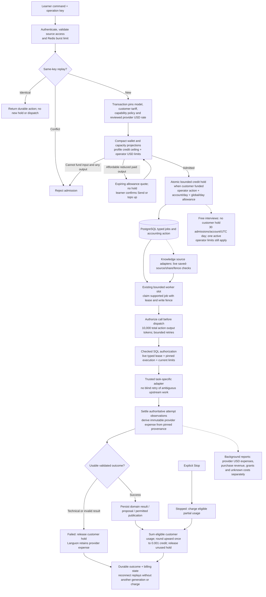

# AI job lifecycle and accounting

Atomic bounded action admission separates learner charges, provider expenses and operator limits.

Typed feature modules retain source authorization, job ownership and result publication.
The queue is PostgreSQL; Redis handles admission burst controls, not financial authority.
Accounting joins the same transaction rather than calling another service. The existing
root worker rotates dictionary/shared speech, conversation, sentence, texts and selection
work within bounded slots. No Kafka, billing microservice or AI gateway is implemented.

New selected text work pins immutable customer tariffs independently from provider USD
rates and capability funding policies. Credit amounts use integer milli-credits internally.
Interview operator funding and unlimited accounts create no customer hold but cannot
bypass reviewed prices, execution limits or shared operator dollar budgets. Admission
reads compact wallet/grant and capacity projections rather than rebuilding ledger history.
The application action default is copied atomically on first admission or profile read,
without overwriting a learner-selected budget. A reduced paid-action allowance needs
confirmation; concurrent balance changes require review
again rather than silently shrinking a previously confirmed output allowance.

Restricted workers dispatch and settle through checked SQL entry points, rather than
choosing arbitrary financial mutations. Dispatch requires the current typed job lease
or worker fence; provider expense identity/rates derive from pinned execution and
terminal observations. Report invalidation is internal to those checked operations.

Every attempt consumes operational allowance; failed attempts do not increase customer
charges. Unknown expense remains unknown. Supporting conversation memory calls are
operator-funded. Successful results remain chargeable; explicit Stop charges eligible
partial usage. Technical failures release the learner hold even if partial text remains.
[Speech](speech-and-pricing.md) has its own indivisible generation and billing deadline.
[Conversations](conversations-and-knowledge.md) persist batched output independently of
browser subscriptions. Sentence preparation uses one explicit parent authorization:
children share its hold, pins, 10,000 output tokens and five-call allowance rather than
receiving fresh budgets automatically. Exhaustion requires explicit Continue with new
authorization. Reporting and bounded cleanup run in background connections.

Knowledge transcription is a native-duration action, not a token action. Its
admission pins source bytes/duration, customer tariff, native provider pricing and
code-owned processing approval; dispatch additionally requires a live worker
observation and fenced lease. Receipt-bound terminal settlement records provider
duration when supplied, otherwise unknown expense, and never lets cancelled output
publish. Private Knowledge translations reuse the Texts action/job authority with
actor-owned overlays; note sentence generation/checking reuses the Learning engine.
Both source adapters recheck live saved-source/share authority and delete or fence
their private work on source removal. These are present implementation paths, while
external-provider activation remains separately gated.

Disabling dictionary credit enforcement now disables new generation admission; it is
not an unaccounted execution route. Read, Accept, cancellation and worker drain remain
available. Deterministic fixtures also use accounted admission. Retained historical
null-snapshot handling is not a current public admission path. Retired model snapshots
fail closed rather than being rewritten. Earlier ADR failure-charge rules are superseded by ADR-0045 for
new action accounting; the fresh-development-ledger cutover does not reinterpret old
whole-credit rows in place. These relationships are source evidence, not a measured
performance or production activation claim.

## Sources

- [apps/backend/src/modules/text-ai/infrastructure/persistence/drizzle/text-ai-admission-participant.ts](../../apps/backend/src/modules/text-ai/infrastructure/persistence/drizzle/text-ai-admission-participant.ts)
- [apps/backend/src/modules/text-ai/application/text-ai-provider-catalog.ts](../../apps/backend/src/modules/text-ai/application/text-ai-provider-catalog.ts)
- [apps/backend/src/modules/ai-credits/application/ai-credit-participant.ts](../../apps/backend/src/modules/ai-credits/application/ai-credit-participant.ts)
- [apps/backend/src/infrastructure/worker/dictionary-worker-runtime.ts](../../apps/backend/src/infrastructure/worker/dictionary-worker-runtime.ts)
- [apps/backend/src/infrastructure/worker/dictionary-worker-command.ts](../../apps/backend/src/infrastructure/worker/dictionary-worker-command.ts)
- [apps/backend/src/modules/dictionaries/application/dictionary-generation-service.ts](../../apps/backend/src/modules/dictionaries/application/dictionary-generation-service.ts)
- [apps/backend/src/modules/learning/application/sentence-worker-service.ts](../../apps/backend/src/modules/learning/application/sentence-worker-service.ts)
- [docs/adr/0012-dictionary-worker-and-document-ingestion.md](../../docs/adr/0012-dictionary-worker-and-document-ingestion.md)
- [docs/adr/0022-ai-credit-ledger-and-generation-settlement.md](../../docs/adr/0022-ai-credit-ledger-and-generation-settlement.md)
- [docs/adr/0026-shared-text-ai-selection-and-user-preferences.md](../../docs/adr/0026-shared-text-ai-selection-and-user-preferences.md)
- [docs/adr/0027-typed-sentence-work-and-shared-ai-accounting.md](../../docs/adr/0027-typed-sentence-work-and-shared-ai-accounting.md)
- [docs/adr/0036-task-specific-text-translation-capacity.md](../../docs/adr/0036-task-specific-text-translation-capacity.md)
- [docs/adr/0037-independent-knowledge-and-agent-proposals.md](../../docs/adr/0037-independent-knowledge-and-agent-proposals.md)
- [docs/adr/0038-preproduction-text-model-retirement.md](../../docs/adr/0038-preproduction-text-model-retirement.md)
- [apps/backend/src/infrastructure/worker/dictionary-worker-environment.ts](../../apps/backend/src/infrastructure/worker/dictionary-worker-environment.ts)
- [docs/adr/0040-preproduction-owner-scoped-audio-retirement.md](../../docs/adr/0040-preproduction-owner-scoped-audio-retirement.md)

- [docs/adr/0045-action-accounting-and-provider-expenses.md](../adr/0045-action-accounting-and-provider-expenses.md)

- [apps/backend/src/modules/ai-credits/infrastructure/persistence/drizzle/drizzle-action-accounting-participant.ts](../../apps/backend/src/modules/ai-credits/infrastructure/persistence/drizzle/drizzle-action-accounting-participant.ts)

- [apps/backend/src/modules/ai-credits/infrastructure/persistence/drizzle/legacy-action-accounting.ts](../../apps/backend/src/modules/ai-credits/infrastructure/persistence/drizzle/legacy-action-accounting.ts)

- [apps/backend/src/modules/ai-credits/infrastructure/persistence/drizzle/drizzle-operator-budget-participant.ts](../../apps/backend/src/modules/ai-credits/infrastructure/persistence/drizzle/drizzle-operator-budget-participant.ts)

- [apps/backend/src/modules/ai-credits/infrastructure/persistence/drizzle/drizzle-capability-policy-participant.ts](../../apps/backend/src/modules/ai-credits/infrastructure/persistence/drizzle/drizzle-capability-policy-participant.ts)

- [apps/backend/src/modules/ai-credits/infrastructure/persistence/drizzle/drizzle-ai-credit-participant.ts](../../apps/backend/src/modules/ai-credits/infrastructure/persistence/drizzle/drizzle-ai-credit-participant.ts)

- [apps/backend/src/infrastructure/text-ai/text-ai-capacity.ts](../../apps/backend/src/infrastructure/text-ai/text-ai-capacity.ts)

- [apps/backend/src/modules/conversations/infrastructure/conversation-accounting.ts](../../apps/backend/src/modules/conversations/infrastructure/conversation-accounting.ts)

- [apps/backend/src/modules/conversations/infrastructure/conversation-action-accounting.ts](../../apps/backend/src/modules/conversations/infrastructure/conversation-action-accounting.ts)

- [apps/backend/src/modules/learner-portraits/infrastructure/interview-accounting.ts](../../apps/backend/src/modules/learner-portraits/infrastructure/interview-accounting.ts)

- [apps/backend/src/modules/ai-credits/infrastructure/accounting-report-worker.ts](../../apps/backend/src/modules/ai-credits/infrastructure/accounting-report-worker.ts)

- [apps/backend/src/modules/dictionaries/infrastructure/dictionary-composition.ts](../../apps/backend/src/modules/dictionaries/infrastructure/dictionary-composition.ts)

- [apps/backend/src/modules/ai-credits/infrastructure/action-allowance-consent.ts](../../apps/backend/src/modules/ai-credits/infrastructure/action-allowance-consent.ts)

- [apps/backend/src/modules/text-ai/infrastructure/persistence/drizzle/action-budget-default.ts](../../apps/backend/src/modules/text-ai/infrastructure/persistence/drizzle/action-budget-default.ts)

- [apps/backend/src/modules/ai-credits/infrastructure/persistence/drizzle/worker-financial-authority.sql](../../apps/backend/src/modules/ai-credits/infrastructure/persistence/drizzle/worker-financial-authority.sql)

- [apps/backend/src/modules/ai-credits/infrastructure/persistence/drizzle/accounting-provider-expense-guards.sql](../../apps/backend/src/modules/ai-credits/infrastructure/persistence/drizzle/accounting-provider-expense-guards.sql)

- [apps/backend/src/modules/learning/infrastructure/persistence/drizzle/drizzle-sentence-preparation-store.ts](../../apps/backend/src/modules/learning/infrastructure/persistence/drizzle/drizzle-sentence-preparation-store.ts)
- [apps/backend/src/modules/knowledge/application/transcription-job-service.ts](../../apps/backend/src/modules/knowledge/application/transcription-job-service.ts)
- [apps/backend/src/modules/knowledge/application/private-translation-service.ts](../../apps/backend/src/modules/knowledge/application/private-translation-service.ts)
- [apps/backend/src/modules/knowledge/infrastructure/transcription-worker-readiness.ts](../../apps/backend/src/modules/knowledge/infrastructure/transcription-worker-readiness.ts)
- [docs/adr/0050-interactive-workbook-content-and-learning-boundaries.md](../adr/0050-interactive-workbook-content-and-learning-boundaries.md)
