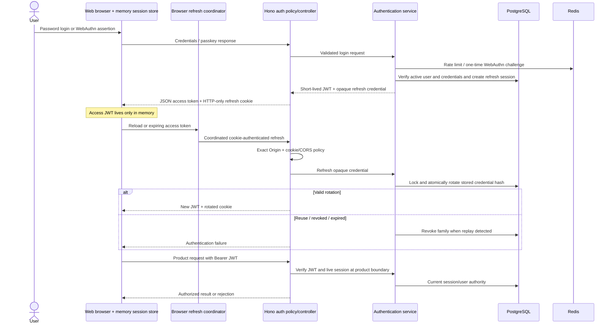

# Authentication and session refresh

Password/passkey login creates a durable session and browser refresh rotates an opaque credential.

Signup creates a pending identity; email ownership must be verified before normal
password login or passkey enrollment. Composition selects a development or disabled
email adapter, not a configured production mail service. JWT signing, Argon2id,
WebAuthn, persistence and Redis remain infrastructure adapters.

The shared coordinator prevents ordinary concurrent browser refresh races; server
rotation is still atomic and replay-revoking. Admin uses its dedicated cookie and
owner membership checks, with a separate UI auth provider; see ADR-0010 through the
[module view](module-boundaries.md). This sequence shows the common web protocol,
not the future native secure-storage transport.

## Sources

- [apps/backend/src/modules/authentication/infrastructure/authentication-composition.ts](../../apps/backend/src/modules/authentication/infrastructure/authentication-composition.ts)
- [apps/backend/src/modules/authentication/application/session-issuer.ts](../../apps/backend/src/modules/authentication/application/session-issuer.ts)
- [apps/backend/src/modules/authentication/application/authentication-service.ts](../../apps/backend/src/modules/authentication/application/authentication-service.ts)
- [apps/backend/src/modules/authentication/interface/http/auth-http-policy.ts](../../apps/backend/src/modules/authentication/interface/http/auth-http-policy.ts)
- [apps/web/src/fsd/entities/session/model/session-store.ts](../../apps/web/src/fsd/entities/session/model/session-store.ts)
- [packages/browser-auth/src/refresh-coordinator.ts](../../packages/browser-auth/src/refresh-coordinator.ts)
- [docs/adr/0001-user-authentication-and-session-strategy.md](../../docs/adr/0001-user-authentication-and-session-strategy.md)
