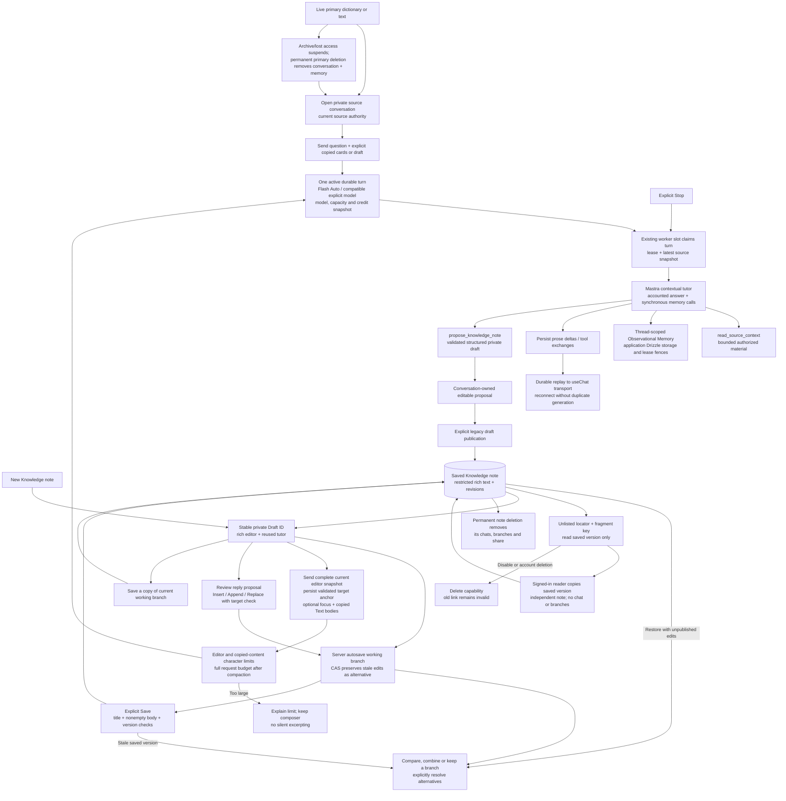

# Conversations and Knowledge workspace

Source chat and note workspaces share durable tutor turns while working drafts,
publication and unlisted sharing have separate boundaries.

Navigation or disconnect does not cancel worker-owned generation; explicit Stop is
a separate command. Failed partial output remains incomplete; learner retry starts
new generation rather than automatically repeating an ambiguous provider request.
The model gate bounds each turn to five provider calls and two memory calls;
observation/reflection run synchronously inside accounted work, with background
buffering and vector recall disabled. Full readable history remains canonical.

Tools can read the current authorized source and propose one bounded note draft;
they cannot publish, overwrite or delete Knowledge. Store-backed Save delegates
publication to the Knowledge transaction participant with ownership/version checks.
The Knowledge service also supports independent manual create/edit, revisions and
restore; restoring a version makes a new saved revision. A note workspace starts
with an empty, recoverable private Draft. Autosave never publishes. Concurrent
edits create branches; the learner chooses which to continue and explicitly
resolves alternatives. Restoring a saved revision while unpublished prose exists
also creates an alternative, and Save waits for resolution. Only a published
version is visible through an unlisted
share; disabling sharing deletes the capability, and a recipient copy is a new
note with no private chat or draft branches.

Explicit attachments are personal copies authorized when read, not extra live source
links. A saved note has no origin dependency and survives conversation deletion.
Conversation-produced note proposals and memory remain conversation-owned.
Knowledge workspace edits belong to the note's private working branch. Each
workspace turn stores its complete editor snapshot, validated cursor/selection
anchor and immutable copied Text references in the user message for Mastra
history. The assistant reply retains the anchor so reopening can safely resume
proposal review; changed document wording requires comparison or reselection.
The current snapshot takes
precedence over older compacted snapshots. The note-to-workspace edge means
reopening a note can resume its latest private conversation, without a stored
origin back-reference to another source.

## Sources

- [docs/adr/0042-knowledge-workspace-document-and-context-boundaries.md](../adr/0042-knowledge-workspace-document-and-context-boundaries.md)
- [docs/user-flows/knowledge-workspace.md](../user-flows/knowledge-workspace.md)
- [apps/backend/src/config/environment.ts](../../apps/backend/src/config/environment.ts)
- [apps/backend/src/modules/conversations/application/workspace-turn-context.ts](../../apps/backend/src/modules/conversations/application/workspace-turn-context.ts)
- [apps/backend/src/modules/knowledge/interface/http/knowledge.routes.ts](../../apps/backend/src/modules/knowledge/interface/http/knowledge.routes.ts)
- [apps/backend/src/modules/knowledge/infrastructure/persistence/drizzle/drizzle-knowledge-store.ts](../../apps/backend/src/modules/knowledge/infrastructure/persistence/drizzle/drizzle-knowledge-store.ts)
- [apps/backend/src/modules/knowledge/infrastructure/persistence/drizzle/schema.ts](../../apps/backend/src/modules/knowledge/infrastructure/persistence/drizzle/schema.ts)
- [apps/web/src/fsd/pages/knowledge/ui/knowledge-detail-page/knowledge-detail-page.tsx](../../apps/web/src/fsd/pages/knowledge/ui/knowledge-detail-page/knowledge-detail-page.tsx)
- [apps/web/src/fsd/pages/knowledge/hooks/use-knowledge-workspace.ts](../../apps/web/src/fsd/pages/knowledge/hooks/use-knowledge-workspace.ts)
- [apps/web/src/fsd/widgets/contextual-assistant/hooks/use-assistant-panel.ts](../../apps/web/src/fsd/widgets/contextual-assistant/hooks/use-assistant-panel.ts)
- [docs/adr/0041-durable-tutor-streaming-presentation.md](../../docs/adr/0041-durable-tutor-streaming-presentation.md)
- [apps/web/src/fsd/entities/conversation/lib/durable-message-projection.ts](../../apps/web/src/fsd/entities/conversation/lib/durable-message-projection.ts)
- [apps/web/src/fsd/widgets/contextual-assistant/hooks/use-conversation-stream.ts](../../apps/web/src/fsd/widgets/contextual-assistant/hooks/use-conversation-stream.ts)
- [apps/web/src/fsd/widgets/contextual-assistant/lib/conversation-stream-session.ts](../../apps/web/src/fsd/widgets/contextual-assistant/lib/conversation-stream-session.ts)
- [apps/web/src/fsd/widgets/contextual-assistant/hooks/use-streaming-text.ts](../../apps/web/src/fsd/widgets/contextual-assistant/hooks/use-streaming-text.ts)
- [apps/web/src/fsd/widgets/contextual-assistant/ui/contextual-assistant/chat-markdown.tsx](../../apps/web/src/fsd/widgets/contextual-assistant/ui/contextual-assistant/chat-markdown.tsx)
- [apps/backend/src/modules/conversations/interface/http/conversation.routes.ts](../../apps/backend/src/modules/conversations/interface/http/conversation.routes.ts)

- [apps/backend/src/modules/conversations/application/conversation-service.ts](../../apps/backend/src/modules/conversations/application/conversation-service.ts)
- [apps/backend/src/modules/conversations/application/conversation-worker-service.ts](../../apps/backend/src/modules/conversations/application/conversation-worker-service.ts)
- [apps/backend/src/modules/conversations/infrastructure/conversation-worker-composition.ts](../../apps/backend/src/modules/conversations/infrastructure/conversation-worker-composition.ts)
- [apps/backend/src/modules/conversations/infrastructure/ai/contextual-tutor-runner.ts](../../apps/backend/src/modules/conversations/infrastructure/ai/contextual-tutor-runner.ts)
- [apps/backend/src/modules/conversations/infrastructure/ai/contextual-tutor-tools.ts](../../apps/backend/src/modules/conversations/infrastructure/ai/contextual-tutor-tools.ts)
- [apps/backend/src/modules/conversations/infrastructure/ai/accounted-tutor-model.ts](../../apps/backend/src/modules/conversations/infrastructure/ai/accounted-tutor-model.ts)
- [apps/backend/src/modules/conversations/infrastructure/ai/conversation-memory-storage.ts](../../apps/backend/src/modules/conversations/infrastructure/ai/conversation-memory-storage.ts)
- [apps/backend/src/modules/conversations/infrastructure/persistence/drizzle/drizzle-conversation-store.ts](../../apps/backend/src/modules/conversations/infrastructure/persistence/drizzle/drizzle-conversation-store.ts)
- [apps/backend/src/modules/knowledge/application/knowledge-service.ts](../../apps/backend/src/modules/knowledge/application/knowledge-service.ts)
- [docs/adr/0037-independent-knowledge-and-agent-proposals.md](../../docs/adr/0037-independent-knowledge-and-agent-proposals.md)
- [apps/web/src/fsd/entities/conversation/api/conversation-api.ts](../../apps/web/src/fsd/entities/conversation/api/conversation-api.ts)
- [apps/web/src/fsd/entities/conversation/api/durable-chat-transport.ts](../../apps/web/src/fsd/entities/conversation/api/durable-chat-transport.ts)
- [apps/backend/tests/unit/modules/conversations/conversation-worker-service.test.ts](../../apps/backend/tests/unit/modules/conversations/conversation-worker-service.test.ts)

Streaming presentation follows [ADR-0041](../adr/0041-durable-tutor-streaming-presentation.md):
active125ms/idle1000ms SSE delivers committed canonical state, then the browser
projects native incremental AI SDK parts and restricted Streamdown Markdown.
Each committed conversation session owns its SDK Chat, callbacks, cache key and
publication epoch; speculative React renders start no subscription. Terminal
access loss purges only that owner and invalidates queued publications.
Snapshots/reconnect still reconcile canonical history; UI reveal and activity
indicators do not execute tools or change durable turn state. The graph's
authority and data-flow relationships remain unchanged.
