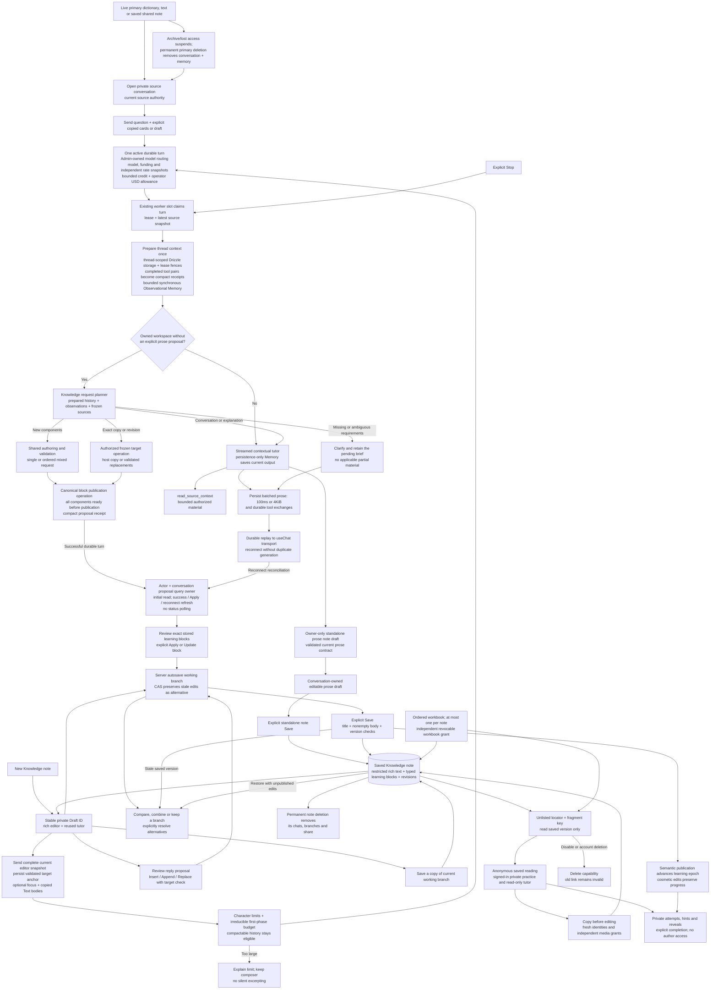

# Conversations and Knowledge workspace

Source chat and note workspaces share durable tutor turns while working drafts,
publication and unlisted sharing have separate boundaries.

Private append/heartbeat progress transactions recheck the active actor with a shared
lifecycle lock, source authority, chat/turn identity, lease and Stop state. They do not
acquire global capacity locks or change billing/publication. Public arbitrary
`withOperation`, admission and settlement keep the global-capacity and actor-update
fences. Batched streaming progress therefore does not serialize all admissions while
retaining the same lifecycle authority checks.

Navigation or disconnect does not cancel worker-owned generation; explicit Stop is
a separate command. Failed partial output remains incomplete; learner retry starts
new generation rather than automatically repeating an ambiguous provider request.
The action bounds aggregate output to 10,000 tokens and separately bounds operator
cost. Reduced affordable output requires a reviewed quote; changed funding requires
confirmation again. Successful answers and eligible explicit Stop usage are charged;
technical failure releases the customer hold. Memory calls remain operator-funded.
The model gate also bounds each turn to five provider calls and two memory calls;
observation/reflection run synchronously inside accounted work, with background
buffering and vector recall disabled. Full readable history remains canonical.

Tools can read the current authorized source and prepare bounded prose drafts or
typed learning proposals; they cannot publish, overwrite or delete a saved note.
The block publication operation stores a reviewable proposal, not a saved document.
Store-backed Save delegates
publication to the Knowledge transaction participant with ownership/version checks.
The Knowledge service also supports independent manual create/edit, revisions and
restore; restoring a version makes a new saved revision. A note workspace starts
with an empty, recoverable private Draft. Autosave never publishes. Concurrent
edits create branches; the learner chooses which to continue and explicitly
resolves alternatives. Restoring a saved revision while unpublished prose exists
also creates an alternative, and Save waits for resolution. Only a published
version is visible through an unlisted
share. Shared-source conversations expose reading/explanation tools and reject
authoring callbacks. Disabling sharing deletes that capability; workbook membership
and independent note shares remain separate grants. A recipient copy is a new
note with fresh block identities and no private chat, progress or draft branches.
Copied uploaded audio has an independent grant, so source deletion does not break
playback.

Version-2 blocks use strict bounded schemas and fixed escaped renderers; arbitrary
HTML and embed code are rejected. Typed AI block proposals capture the owner
working target and require preview/Apply before a separate explicit Save.
Private learner state is stored separately from document content. Publication
maintains monotonic semantic epochs; earlier wording restored later cannot revive
old mastery. Workbook progress summarizes only the current learner's explicit
note completions, including updated-since-completion notices. Course generation
and workbook-wide AI context remain deferred under ADR-0050.

Explicit attachments are personal copies authorized when read, not extra live source
links. A saved note has no origin dependency and survives conversation deletion.
Conversation-produced note proposals and memory remain conversation-owned.
Knowledge workspace edits belong to the note's private working branch. Each
workspace turn stores its complete editor snapshot, validated cursor/selection
anchor and immutable copied Text references in the user message for Mastra
history. The assistant reply retains the anchor so reopening can safely resume
proposal review; changed document wording requires comparison or reselection.
The current snapshot takes
precedence over older compacted snapshots. The note-to-workspace edge means
reopening a note can resume its latest private conversation, without a stored
origin back-reference to another source.

## Implementation reconciliation

The source resolver projects only effective learner-visible dictionary fields through
`projectConversationDictionaryCards`; prepared turn reuse still checks the locked
chat and source snapshot through `assertPreparedConversationCurrent`. Knowledge
store methods allocate a fresh persistence context per call. The authoring form
facade delegates to typed readers and validates the completed candidate once;
this does not publish a working draft. Model selection follows the admin-owned
routing revision under ADR-0046, rather than a learner-selected model. These
internal extractions preserve the graph's ownership, Apply and explicit Save edges.

[ADR-0055](../adr/0055-learning-content-context-and-publication.md) separates
mandatory current input from reducible history and budgets the actual planner,
authoring and streamed-answer phases independently. An irreducible overflow fails
before a turn or credit hold; the dispatch gate still checks each real model call.
Historical editor snapshots and completed tool pairs become model-context receipts,
while canonical messages, exact current sources and active tool dependencies remain
available under their existing authorization. Receipts never grant source authority.
One explicit memory preparation supplies both the planner and streamed path;
streamed output uses SDK history persistence without a second automatic memory cycle.
Persisted memory configuration contains only allowlisted scalar scope/budget settings
and numeric thresholds; live model adapters, credentials, headers and executable
configuration remain in process. Record reads and writes enforce the same projection.

The capability registry and shared authoring/publication operation serve dedicated
tools and coordinated mixed generation. All new components validate before one
proposal is stored. Copy and revision operations resolve exact frozen targets;
revisions reconcile identities and counts before any proposal write. Missing source
or material requirements produce clarification instead of reconstructed content.
The current pre-release Knowledge contract is schema version 2 for both prose and
block documents; historical compatibility-rollout text in ADR-0050 does not describe
an active dual-format reader.

The browser has one proposal query owner keyed by actor and conversation. Initial
history, a new successful proposal-producing turn, explicit Apply and reconnect
reconcile that cache. Queued/running/failed status updates do not poll it. Durable
events own conversation detail after Send; ordinary sends do not reload an unchanged
workspace. The first eligible Untitled-note admission still synchronizes automatic
naming and its resulting branch version.

## Sources

- [ADR-0055: learning-content context and publication](../adr/0055-learning-content-context-and-publication.md)
- [Phase input budgets](../../apps/backend/src/modules/conversations/application/tutor-context-budget.ts)
- [Exact planner envelope and retained brief](../../apps/backend/src/modules/conversations/application/tutor-planner-prompt.ts)
- [Capability registry](../../apps/backend/src/modules/conversations/application/learning-content-registry.ts)
- [Canonical revision reconciliation](../../apps/backend/src/modules/conversations/application/learning-block-revision.ts)
- [Knowledge request execution](../../apps/backend/src/modules/conversations/infrastructure/ai/tutor-request-execution.ts)
- [Prepared history and receipt projection](../../apps/backend/src/modules/conversations/infrastructure/ai/tutor-history-context.ts)
- [Shared raw authoring](../../apps/backend/src/modules/conversations/infrastructure/ai/learning-content-authoring.ts)
- [Canonical proposal publication](../../apps/backend/src/modules/conversations/infrastructure/ai/learning-content-operations.ts)
- [Frozen copy and revision operations](../../apps/backend/src/modules/conversations/infrastructure/ai/learning-block-operations.ts)
- [Dedicated learning-content tools](../../apps/backend/src/modules/conversations/infrastructure/ai/learning-content-tools.ts)
- [Authorized learning-tool sources](../../apps/backend/src/modules/conversations/infrastructure/ai/learning-tool-sources.ts)
- [Canonical memory message guards](../../apps/backend/src/modules/conversations/infrastructure/ai/conversation-memory-messages.ts)
- [Persisted memory configuration projection](../../apps/backend/src/modules/conversations/infrastructure/ai/conversation-memory-config.ts)
- [Thread-scoped observational memory records](../../apps/backend/src/modules/conversations/infrastructure/ai/conversation-memory-records.ts)
- [Worker completion authority](../../apps/backend/src/modules/conversations/infrastructure/persistence/drizzle/conversation-worker-completion.ts)
- [Proposal query ownership](../../apps/web/src/fsd/features/knowledge-notes/hooks/use-block-proposals.ts)
- [Successful proposal completion identity](../../apps/web/src/fsd/features/knowledge-notes/lib/proposal-completions.ts)
- [docs/adr/0042-knowledge-workspace-document-and-context-boundaries.md](../adr/0042-knowledge-workspace-document-and-context-boundaries.md)
- [docs/user-flows/knowledge-workspace.md](../user-flows/knowledge-workspace.md)
- [apps/backend/src/config/environment.ts](../../apps/backend/src/config/environment.ts)
- [apps/backend/src/modules/conversations/application/workspace-turn-context.ts](../../apps/backend/src/modules/conversations/application/workspace-turn-context.ts)
- [apps/backend/src/modules/knowledge/interface/http/knowledge.routes.ts](../../apps/backend/src/modules/knowledge/interface/http/knowledge.routes.ts)
- [apps/backend/src/modules/knowledge/infrastructure/persistence/drizzle/drizzle-knowledge-store.ts](../../apps/backend/src/modules/knowledge/infrastructure/persistence/drizzle/drizzle-knowledge-store.ts)
- [apps/backend/src/modules/knowledge/infrastructure/persistence/drizzle/schema.ts](../../apps/backend/src/modules/knowledge/infrastructure/persistence/drizzle/schema.ts)
- [apps/web/src/fsd/pages/knowledge/ui/knowledge-detail-page/knowledge-detail-page.tsx](../../apps/web/src/fsd/pages/knowledge/ui/knowledge-detail-page/knowledge-detail-page.tsx)
- [apps/web/src/fsd/pages/knowledge/hooks/use-knowledge-workspace.ts](../../apps/web/src/fsd/pages/knowledge/hooks/use-knowledge-workspace.ts)
- [apps/web/src/fsd/widgets/contextual-assistant/hooks/use-assistant-panel.ts](../../apps/web/src/fsd/widgets/contextual-assistant/hooks/use-assistant-panel.ts)
- [docs/adr/0041-durable-tutor-streaming-presentation.md](../../docs/adr/0041-durable-tutor-streaming-presentation.md)
- [apps/web/src/fsd/entities/conversation/lib/durable-message-projection.ts](../../apps/web/src/fsd/entities/conversation/lib/durable-message-projection.ts)
- [apps/web/src/fsd/widgets/contextual-assistant/hooks/use-conversation-stream.ts](../../apps/web/src/fsd/widgets/contextual-assistant/hooks/use-conversation-stream.ts)
- [apps/web/src/fsd/widgets/contextual-assistant/lib/conversation-stream-session.ts](../../apps/web/src/fsd/widgets/contextual-assistant/lib/conversation-stream-session.ts)
- [apps/web/src/fsd/widgets/contextual-assistant/hooks/use-streaming-text.ts](../../apps/web/src/fsd/widgets/contextual-assistant/hooks/use-streaming-text.ts)
- [apps/web/src/fsd/widgets/contextual-assistant/ui/contextual-assistant/chat-markdown.tsx](../../apps/web/src/fsd/widgets/contextual-assistant/ui/contextual-assistant/chat-markdown.tsx)
- [apps/backend/src/modules/conversations/interface/http/conversation.routes.ts](../../apps/backend/src/modules/conversations/interface/http/conversation.routes.ts)

- [apps/backend/src/modules/conversations/application/conversation-service.ts](../../apps/backend/src/modules/conversations/application/conversation-service.ts)
- [apps/backend/src/modules/conversations/application/conversation-worker-service.ts](../../apps/backend/src/modules/conversations/application/conversation-worker-service.ts)
- [apps/backend/src/modules/conversations/infrastructure/conversation-worker-composition.ts](../../apps/backend/src/modules/conversations/infrastructure/conversation-worker-composition.ts)
- [apps/backend/src/modules/conversations/infrastructure/ai/contextual-tutor-runner.ts](../../apps/backend/src/modules/conversations/infrastructure/ai/contextual-tutor-runner.ts)
- [apps/backend/src/modules/conversations/infrastructure/ai/contextual-tutor-tools.ts](../../apps/backend/src/modules/conversations/infrastructure/ai/contextual-tutor-tools.ts)
- [apps/backend/src/modules/conversations/infrastructure/ai/accounted-tutor-model.ts](../../apps/backend/src/modules/conversations/infrastructure/ai/accounted-tutor-model.ts)
- [apps/backend/src/modules/conversations/infrastructure/ai/conversation-memory-storage.ts](../../apps/backend/src/modules/conversations/infrastructure/ai/conversation-memory-storage.ts)
- [apps/backend/src/modules/conversations/infrastructure/persistence/drizzle/drizzle-conversation-store.ts](../../apps/backend/src/modules/conversations/infrastructure/persistence/drizzle/drizzle-conversation-store.ts)
- [apps/backend/src/modules/knowledge/application/knowledge-service.ts](../../apps/backend/src/modules/knowledge/application/knowledge-service.ts)
- [docs/adr/0037-independent-knowledge-and-agent-proposals.md](../../docs/adr/0037-independent-knowledge-and-agent-proposals.md)
- [apps/web/src/fsd/entities/conversation/api/conversation-api.ts](../../apps/web/src/fsd/entities/conversation/api/conversation-api.ts)
- [apps/web/src/fsd/entities/conversation/api/durable-chat-transport.ts](../../apps/web/src/fsd/entities/conversation/api/durable-chat-transport.ts)
- [apps/backend/tests/unit/modules/conversations/conversation-worker-service.test.ts](../../apps/backend/tests/unit/modules/conversations/conversation-worker-service.test.ts)

Streaming presentation follows [ADR-0041](../adr/0041-durable-tutor-streaming-presentation.md):
active125ms/idle1000ms SSE delivers committed canonical state, then the browser
projects native incremental AI SDK parts and restricted Streamdown Markdown.
Each committed conversation session owns its SDK Chat, callbacks, cache key and
publication epoch; speculative React renders start no subscription. Terminal
access loss purges only that owner and invalidates queued publications.
Snapshots/reconnect still reconcile canonical history; UI reveal and activity
indicators do not execute tools or change durable turn state. The graph's
authority and data-flow relationships remain unchanged.

- [docs/adr/0045-action-accounting-and-provider-expenses.md](../adr/0045-action-accounting-and-provider-expenses.md)

- [apps/backend/src/modules/conversations/application/turn-text-buffer.ts](../../apps/backend/src/modules/conversations/application/turn-text-buffer.ts)

- [apps/backend/src/modules/conversations/infrastructure/conversation-accounting.ts](../../apps/backend/src/modules/conversations/infrastructure/conversation-accounting.ts)

- [apps/backend/src/modules/conversations/infrastructure/conversation-action-accounting.ts](../../apps/backend/src/modules/conversations/infrastructure/conversation-action-accounting.ts)

- [apps/backend/src/modules/conversations/infrastructure/persistence/drizzle/conversation-source.ts](../../apps/backend/src/modules/conversations/infrastructure/persistence/drizzle/conversation-source.ts)

- [apps/backend/src/modules/conversations/infrastructure/persistence/drizzle/conversation-turn-admission.ts](../../apps/backend/src/modules/conversations/infrastructure/persistence/drizzle/conversation-turn-admission.ts)
- [apps/backend/src/modules/conversations/infrastructure/persistence/drizzle/conversation-admission-snapshot.ts](../../apps/backend/src/modules/conversations/infrastructure/persistence/drizzle/conversation-admission-snapshot.ts)
- [apps/backend/src/modules/conversations/infrastructure/persistence/drizzle/conversation-dictionary-material.ts](../../apps/backend/src/modules/conversations/infrastructure/persistence/drizzle/conversation-dictionary-material.ts)
- [apps/backend/src/modules/text-ai/infrastructure/persistence/drizzle/text-ai-admission-participant.ts](../../apps/backend/src/modules/text-ai/infrastructure/persistence/drizzle/text-ai-admission-participant.ts)
- [apps/backend/src/modules/text-ai/infrastructure/persistence/drizzle/routing-admission.ts](../../apps/backend/src/modules/text-ai/infrastructure/persistence/drizzle/routing-admission.ts)
- [docs/adr/0046-admin-owned-text-ai-routing.md](../../docs/adr/0046-admin-owned-text-ai-routing.md)
- [apps/web/src/fsd/features/knowledge-notes/lib/learning-block-form.ts](../../apps/web/src/fsd/features/knowledge-notes/lib/learning-block-form.ts)
- [apps/web/src/fsd/features/knowledge-notes/lib/block-form-definition.ts](../../apps/web/src/fsd/features/knowledge-notes/lib/block-form-definition.ts)
- [apps/web/src/fsd/features/knowledge-notes/lib/block-form-read-context.ts](../../apps/web/src/fsd/features/knowledge-notes/lib/block-form-read-context.ts)
- [apps/web/src/fsd/features/knowledge-notes/lib/read-block-form.ts](../../apps/web/src/fsd/features/knowledge-notes/lib/read-block-form.ts)
- [apps/web/src/fsd/features/knowledge-notes/lib/read-media-block-form.ts](../../apps/web/src/fsd/features/knowledge-notes/lib/read-media-block-form.ts)
- [apps/web/src/fsd/features/knowledge-notes/lib/read-text-block-form.ts](../../apps/web/src/fsd/features/knowledge-notes/lib/read-text-block-form.ts)
- [apps/web/src/fsd/features/knowledge-notes/lib/read-exercise-block-form.ts](../../apps/web/src/fsd/features/knowledge-notes/lib/read-exercise-block-form.ts)
