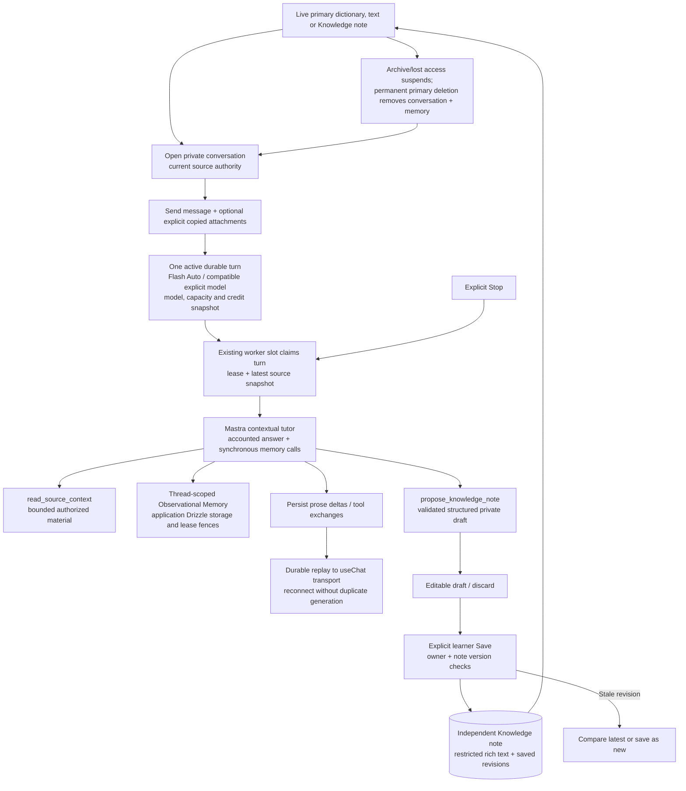

# Conversations and independent Knowledge

Durable contextual chat produces editable private drafts; only an explicit learner command publishes an independent note.

Navigation or disconnect does not cancel worker-owned generation; explicit Stop is
a separate command. Failed partial output remains incomplete; learner retry starts
new generation rather than automatically repeating an ambiguous provider request.
The model gate bounds each turn to five provider calls and two memory calls;
observation/reflection run synchronously inside accounted work, with background
buffering and vector recall disabled. Full readable history remains canonical.

Tools can read the current authorized source and propose one bounded note draft;
they cannot publish, overwrite or delete Knowledge. Store-backed Save delegates
publication to the Knowledge transaction participant with ownership/version checks.
The Knowledge service also supports independent manual create/edit, revisions and
restore; restoring a version makes a new saved revision.

Explicit attachments are personal copies authorized when read, not extra live source
links. A saved note has no origin dependency and survives conversation deletion.
Unsaved drafts and memory remain conversation-owned. The diagram's note-to-source
edge means a later conversation can use that note as its primary source; it does
not create a back-reference from the note to its old conversation.

## Sources

- [apps/backend/src/modules/conversations/application/conversation-service.ts](../../apps/backend/src/modules/conversations/application/conversation-service.ts)
- [apps/backend/src/modules/conversations/application/conversation-worker-service.ts](../../apps/backend/src/modules/conversations/application/conversation-worker-service.ts)
- [apps/backend/src/modules/conversations/infrastructure/conversation-worker-composition.ts](../../apps/backend/src/modules/conversations/infrastructure/conversation-worker-composition.ts)
- [apps/backend/src/modules/conversations/infrastructure/ai/contextual-tutor-runner.ts](../../apps/backend/src/modules/conversations/infrastructure/ai/contextual-tutor-runner.ts)
- [apps/backend/src/modules/conversations/infrastructure/ai/contextual-tutor-tools.ts](../../apps/backend/src/modules/conversations/infrastructure/ai/contextual-tutor-tools.ts)
- [apps/backend/src/modules/conversations/infrastructure/ai/accounted-tutor-model.ts](../../apps/backend/src/modules/conversations/infrastructure/ai/accounted-tutor-model.ts)
- [apps/backend/src/modules/conversations/infrastructure/ai/conversation-memory-storage.ts](../../apps/backend/src/modules/conversations/infrastructure/ai/conversation-memory-storage.ts)
- [apps/backend/src/modules/conversations/infrastructure/persistence/drizzle/drizzle-conversation-store.ts](../../apps/backend/src/modules/conversations/infrastructure/persistence/drizzle/drizzle-conversation-store.ts)
- [apps/backend/src/modules/knowledge/application/knowledge-service.ts](../../apps/backend/src/modules/knowledge/application/knowledge-service.ts)
- [docs/adr/0037-independent-knowledge-and-agent-proposals.md](../../docs/adr/0037-independent-knowledge-and-agent-proposals.md)
- [apps/web/src/fsd/entities/conversation/api/conversation-api.ts](../../apps/web/src/fsd/entities/conversation/api/conversation-api.ts)
- [apps/web/src/fsd/entities/conversation/api/durable-chat-transport.ts](../../apps/web/src/fsd/entities/conversation/api/durable-chat-transport.ts)
- [apps/backend/tests/unit/modules/conversations/conversation-worker-service.test.ts](../../apps/backend/tests/unit/modules/conversations/conversation-worker-service.test.ts)
