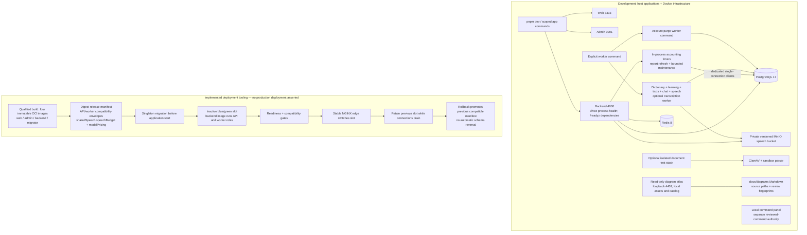

# Development and deployment tooling

Local process topology and implemented release mechanics are distinct from an actually deployed environment.

The root Compose default provides loopback PostgreSQL, Redis and MinIO; app
containers are an optional `apps` profile. Ordinary development runs applications
on the host. Root `dev` does not implicitly prove a separate durable worker is
running: use its explicit command when a journey needs jobs. The account-purge
worker is also a separate command with its own authority. The shared worker can
compose a transcription handler, but it dispatches only when reviewed
transcription configuration, processing approval, worker observation and local
credential/configuration gates are all satisfied; development topology does not
activate external processing.

The user states this project is in development and has no production deployment.
OCI/NGINX/blue-green nodes describe repository tooling and accepted deployment
design, not observed hosts or live traffic. The backend worker is a service role
from the backend image, not a fifth image identity. Scanner/parser composition is
implemented and configuration gated; disposable document services do not prove
production activation. The diagram atlas is a read-only Node server at loopback port 4401 under ADR-0039,
with fixed local assets and a confined diagram catalog. It neither executes reviewed
commands nor serves arbitrary source files. Backend canonical operational endpoints
are `/livez` and `/readyz`; the retired backend `/health` alias is absent. The
atlas's own `/health` route is an independent local-tool endpoint.

Release creation accepts `--shared-speech` and `--model-pricing` JSON. Current
`sharedSpeech.speechBudget` declares character, per-clip cost, owner daily and global
daily ceilings; compatibility checks protect overlapping workers. ADR-0040 retires
the old `pronunciationAudio` metadata/CLI namespace while preserving live speech
budgets and version gates. Current provider/storage environment names remain
`DICTIONARY_AUDIO_*`. The dev command panel and diagram viewer have independent
local authority; neither browsing nor a diagram authorizes deployment or mutation.

The API process also schedules bounded accounting maintenance and report refresh. Each
uses a dedicated single-connection database client; admission does not await either timer.
Conversation maintenance follows the accounting maintenance callback. This does not add
a worker image or service. The development-only accounting cutover requires drained work
and a fresh empty ledger; it is not a deployable conversion of old credit units.

## Sources

- [compose.yaml](../../compose.yaml)
- [package.json](../../package.json)
- [apps/backend/src/infrastructure/worker/dictionary-worker-command.ts](../../apps/backend/src/infrastructure/worker/dictionary-worker-command.ts)
- [apps/backend/src/infrastructure/worker/account-purge-command.ts](../../apps/backend/src/infrastructure/worker/account-purge-command.ts)
- [infra/test/document-services.compose.yaml](../../infra/test/document-services.compose.yaml)
- [infra/deploy/compose/apps.compose.yaml](../../infra/deploy/compose/apps.compose.yaml)
- [infra/deploy/lib/deployment.mjs](../../infra/deploy/lib/deployment.mjs)
- [infra/deploy/lib/manifest.mjs](../../infra/deploy/lib/manifest.mjs)
- [infra/nginx/nginx.conf](../../infra/nginx/nginx.conf)
- [docs/adr/0009-release-and-deployment-platform.md](../../docs/adr/0009-release-and-deployment-platform.md)
- [docs/adr/0012-dictionary-worker-and-document-ingestion.md](../../docs/adr/0012-dictionary-worker-and-document-ingestion.md)
- [apps/backend/src/modules/health/interface/http/health.route.ts](../../apps/backend/src/modules/health/interface/http/health.route.ts)
- [scripts/architecture-viewer/server.mjs](../../scripts/architecture-viewer/server.mjs)
- [scripts/architecture-viewer/catalog.mjs](../../scripts/architecture-viewer/catalog.mjs)
- [scripts/release-manifest.mjs](../../scripts/release-manifest.mjs)
- [infra/deploy/lib/shared-speech.mjs](../../infra/deploy/lib/shared-speech.mjs)
- [docs/adr/0039-source-backed-local-diagram-atlas.md](../../docs/adr/0039-source-backed-local-diagram-atlas.md)
- [docs/adr/0040-preproduction-owner-scoped-audio-retirement.md](../../docs/adr/0040-preproduction-owner-scoped-audio-retirement.md)

- [docs/adr/0045-action-accounting-and-provider-expenses.md](../adr/0045-action-accounting-and-provider-expenses.md)

- [apps/backend/src/index.ts](../../apps/backend/src/index.ts)

- [apps/backend/src/infrastructure/text-ai/accounting-maintenance.ts](../../apps/backend/src/infrastructure/text-ai/accounting-maintenance.ts)

- [apps/backend/src/modules/ai-credits/infrastructure/accounting-report-worker.ts](../../apps/backend/src/modules/ai-credits/infrastructure/accounting-report-worker.ts)
- [apps/backend/src/modules/knowledge/infrastructure/transcription-job-composition.ts](../../apps/backend/src/modules/knowledge/infrastructure/transcription-job-composition.ts)
- [apps/backend/src/modules/knowledge/infrastructure/transcription-worker-readiness.ts](../../apps/backend/src/modules/knowledge/infrastructure/transcription-worker-readiness.ts)
