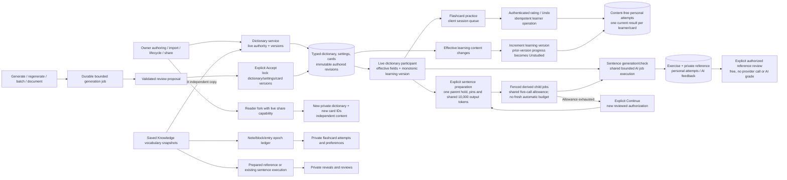

# Dictionaries and learning

Authored vocabulary, review-first AI generation and personal practice use distinct ownership and revision rules.

Dictionary defaults and nullable card overrides resolve server-side; dormant values
are retained when disabled. Forking creates independent identities and does not
inherit personal progress. Sharing uses a random locator plus a fragment capability
forwarded in a dedicated header, with digest-only durable storage and live checks.

Dictionary AI proposals require acceptance with version checks. The separate
[selected-text Add](texts-and-vocabulary.md) is an explicit publication exception.
Learning stores content-free flashcard history, and content changes invalidate via
a monotonic learning version, not by resurrecting a prior content hash. Undo checks
ordering and version. Client session queues are not resumable server queue records.

Cards default enabled under ADR-0025 with an explicit off switch. Sentence exercises
and personal checks have their own typed storage; generated references are omitted
from ordinary projections. The free reference action records a manual review and
does not claim objective scoring. Permanent content deletion cascades linked
progress; account purge also removes personal state on foreign dictionaries.

Dictionary accounting disabled means new generation admission is disabled, while
read/Accept/cancellation/drain remain available; it never means free unaccounted work.
Preparation children can spend only their current parent authorization; current action,
lease/fence and mapped child identity are checked before creation and dispatch. Partial
prepared output remains reusable; an exhausted parent cannot silently refill itself.
Saved Knowledge vocabulary is a source adapter, rather than a dictionary alias:
practice resolves live saved-note/share authority and stores actor-private attempts
against note/block/entry epochs. Saving selected entries to a dictionary is an
explicit independent copy. Prepared bilingual examples permit free manual reference
practice; paid generation/checking uses the existing sentence engine, with source
authority rechecked before dispatch and publication. Note deletion or revocation
removes source-bound private work while independent dictionary copies survive.

New selected dictionary and sentence jobs use shared action accounting: an immutable
funding/tariff/provider snapshot, bounded hold and total output allowance, then settlement
against validated usable results. Technical failures release customer funds while provider
expense remains recorded. These accounting changes do not change the dictionary proposal
Accept or personal-practice ownership edges shown above. See [AI job lifecycle](ai-job-lifecycle.md).

## Sources

- [apps/backend/src/modules/dictionaries/application/dictionary-service.ts](../../apps/backend/src/modules/dictionaries/application/dictionary-service.ts)
- [apps/backend/src/modules/dictionaries/application/dictionary-generation-service.ts](../../apps/backend/src/modules/dictionaries/application/dictionary-generation-service.ts)
- [apps/backend/src/modules/dictionaries/infrastructure/persistence/drizzle/drizzle-dictionary-generation-store.ts](../../apps/backend/src/modules/dictionaries/infrastructure/persistence/drizzle/drizzle-dictionary-generation-store.ts)
- [apps/backend/src/modules/learning/infrastructure/learning-composition.ts](../../apps/backend/src/modules/learning/infrastructure/learning-composition.ts)
- [apps/backend/src/modules/learning/application/learning-service.ts](../../apps/backend/src/modules/learning/application/learning-service.ts)
- [apps/backend/src/modules/learning/application/sentence-worker-service.ts](../../apps/backend/src/modules/learning/application/sentence-worker-service.ts)
- [apps/web/src/fsd/features/flashcard-training/model/practice-session.ts](../../apps/web/src/fsd/features/flashcard-training/model/practice-session.ts)
- [docs/adr/0011-dictionary-persistence-and-composition.md](../../docs/adr/0011-dictionary-persistence-and-composition.md)
- [docs/adr/0024-flashcard-learning-state-and-revisions.md](../../docs/adr/0024-flashcard-learning-state-and-revisions.md)
- [docs/adr/0025-flashcard-capability-enabled-by-default.md](../../docs/adr/0025-flashcard-capability-enabled-by-default.md)
- [docs/adr/0027-typed-sentence-work-and-shared-ai-accounting.md](../../docs/adr/0027-typed-sentence-work-and-shared-ai-accounting.md)
- [apps/web/src/fsd/features/flashcard-training/api/learning-api.ts](../../apps/web/src/fsd/features/flashcard-training/api/learning-api.ts)

- [docs/adr/0045-action-accounting-and-provider-expenses.md](../adr/0045-action-accounting-and-provider-expenses.md)

- [apps/backend/src/modules/ai-credits/infrastructure/persistence/drizzle/legacy-action-accounting.ts](../../apps/backend/src/modules/ai-credits/infrastructure/persistence/drizzle/legacy-action-accounting.ts)

- [apps/backend/src/modules/learning/infrastructure/persistence/drizzle/drizzle-sentence-worker-store.ts](../../apps/backend/src/modules/learning/infrastructure/persistence/drizzle/drizzle-sentence-worker-store.ts)

- [apps/backend/src/modules/dictionaries/infrastructure/dictionary-composition.ts](../../apps/backend/src/modules/dictionaries/infrastructure/dictionary-composition.ts)

- [apps/backend/src/modules/learning/infrastructure/persistence/drizzle/drizzle-sentence-preparation-store.ts](../../apps/backend/src/modules/learning/infrastructure/persistence/drizzle/drizzle-sentence-preparation-store.ts)

- [apps/backend/src/modules/learning/infrastructure/persistence/drizzle/sentence-preparation-accounting.sql](../../apps/backend/src/modules/learning/infrastructure/persistence/drizzle/sentence-preparation-accounting.sql)
- [apps/backend/src/modules/knowledge/application/vocabulary-practice-service.ts](../../apps/backend/src/modules/knowledge/application/vocabulary-practice-service.ts)
- [apps/backend/src/modules/knowledge/application/knowledge-sentence-free-store.ts](../../apps/backend/src/modules/knowledge/application/knowledge-sentence-free-store.ts)
- [apps/backend/src/modules/knowledge/infrastructure/persistence/drizzle/learning-epochs.ts](../../apps/backend/src/modules/knowledge/infrastructure/persistence/drizzle/learning-epochs.ts)
- [docs/adr/0050-interactive-workbook-content-and-learning-boundaries.md](../adr/0050-interactive-workbook-content-and-learning-boundaries.md)
