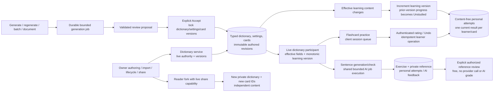

# Dictionaries and learning

Authored vocabulary, review-first AI generation and personal practice use distinct ownership and revision rules.

Dictionary defaults and nullable card overrides resolve server-side; dormant values
are retained when disabled. Forking creates independent identities and does not
inherit personal progress. Sharing uses a random locator plus a fragment capability
forwarded in a dedicated header, with digest-only durable storage and live checks.

Dictionary AI proposals require acceptance with version checks. The separate
[selected-text Add](texts-and-vocabulary.md) is an explicit publication exception.
Learning stores content-free flashcard history, and content changes invalidate via
a monotonic learning version, not by resurrecting a prior content hash. Undo checks
ordering and version. Client session queues are not resumable server queue records.

Cards default enabled under ADR-0025 with an explicit off switch. Sentence exercises
and personal checks have their own typed storage; generated references are omitted
from ordinary projections. The free reference action records a manual review and
does not claim objective scoring. Permanent content deletion cascades linked
progress; account purge also removes personal state on foreign dictionaries.

## Sources

- [apps/backend/src/modules/dictionaries/application/dictionary-service.ts](../../apps/backend/src/modules/dictionaries/application/dictionary-service.ts)
- [apps/backend/src/modules/dictionaries/application/dictionary-generation-service.ts](../../apps/backend/src/modules/dictionaries/application/dictionary-generation-service.ts)
- [apps/backend/src/modules/dictionaries/infrastructure/persistence/drizzle/drizzle-dictionary-generation-store.ts](../../apps/backend/src/modules/dictionaries/infrastructure/persistence/drizzle/drizzle-dictionary-generation-store.ts)
- [apps/backend/src/modules/learning/infrastructure/learning-composition.ts](../../apps/backend/src/modules/learning/infrastructure/learning-composition.ts)
- [apps/backend/src/modules/learning/application/learning-service.ts](../../apps/backend/src/modules/learning/application/learning-service.ts)
- [apps/backend/src/modules/learning/application/sentence-worker-service.ts](../../apps/backend/src/modules/learning/application/sentence-worker-service.ts)
- [apps/web/src/fsd/features/flashcard-training/model/practice-session.ts](../../apps/web/src/fsd/features/flashcard-training/model/practice-session.ts)
- [docs/adr/0011-dictionary-persistence-and-composition.md](../../docs/adr/0011-dictionary-persistence-and-composition.md)
- [docs/adr/0024-flashcard-learning-state-and-revisions.md](../../docs/adr/0024-flashcard-learning-state-and-revisions.md)
- [docs/adr/0025-flashcard-capability-enabled-by-default.md](../../docs/adr/0025-flashcard-capability-enabled-by-default.md)
- [docs/adr/0027-typed-sentence-work-and-shared-ai-accounting.md](../../docs/adr/0027-typed-sentence-work-and-shared-ai-accounting.md)
- [apps/web/src/fsd/features/flashcard-training/api/learning-api.ts](../../apps/web/src/fsd/features/flashcard-training/api/learning-api.ts)
