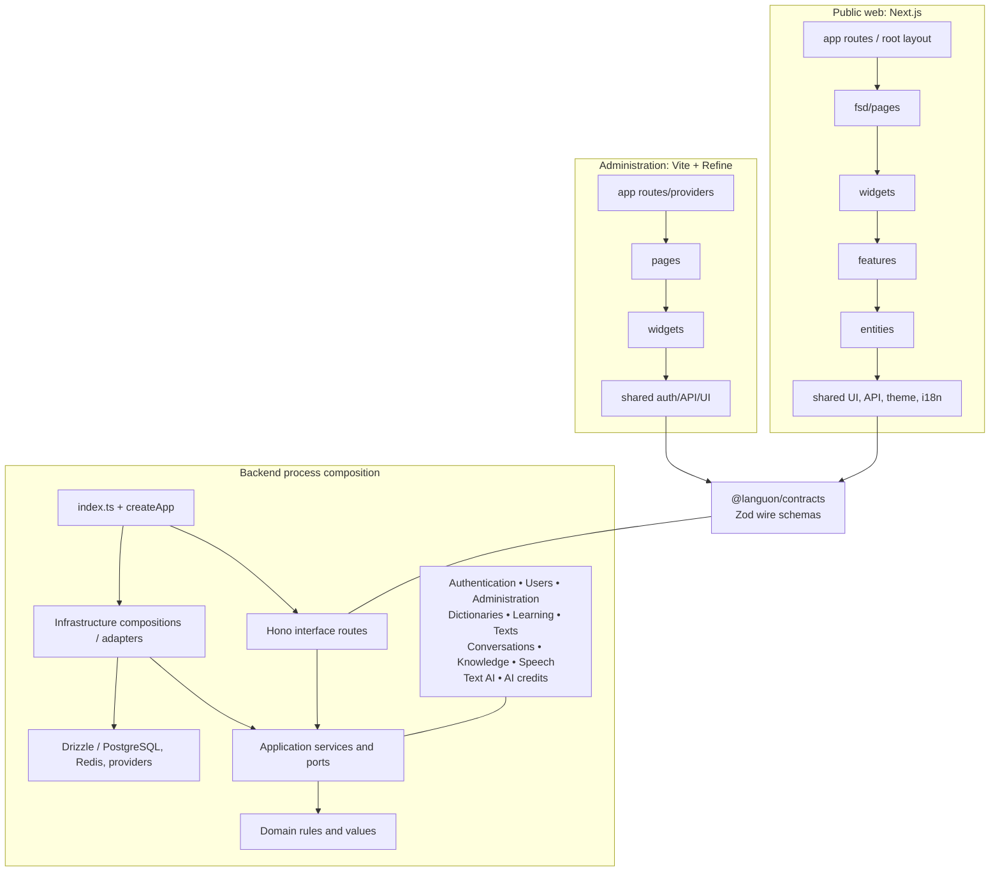

# Module and layer boundaries

Composition roots connect typed business modules and app-local frontend layers.

Arrows inside each app show allowed import/composition direction, not a network
request through every layer. Existing slices can import any permitted lower layer;
they need not create a pass-through component at each level. Root composition wires
concrete adapters into application ports. Infrastructure transaction participants
coordinate cross-module invariants while application/domain code stays free of SQL
and vendor SDKs. `app.ts` mounts the modules actually supplied by `index.ts`.
The Knowledge and Conversations compositions share a typed note transaction
participant for source reads, first-message draft naming and explicit proposal
publication. Knowledge owns working branches and share capabilities; Conversations
owns private turns and Mastra history.

Web and admin share public framework-neutral packages rather than application source.
Admin intentionally uses its own four-layer structure under ADR-0010. This diagram
summarizes inspected composition roots; it is not an automated proof of all imports.

## Sources

- [apps/backend/src/modules/conversations/infrastructure/conversations-composition.ts](../../apps/backend/src/modules/conversations/infrastructure/conversations-composition.ts)
- [apps/backend/src/modules/knowledge/infrastructure/knowledge-composition.ts](../../apps/backend/src/modules/knowledge/infrastructure/knowledge-composition.ts)
- [docs/adr/0042-knowledge-workspace-document-and-context-boundaries.md](../adr/0042-knowledge-workspace-document-and-context-boundaries.md)
- [apps/backend/src/index.ts](../../apps/backend/src/index.ts)
- [apps/backend/src/app.ts](../../apps/backend/src/app.ts)
- [apps/backend/src/modules/dictionaries/infrastructure/dictionary-composition.ts](../../apps/backend/src/modules/dictionaries/infrastructure/dictionary-composition.ts)
- [apps/backend/src/modules/learning/infrastructure/learning-composition.ts](../../apps/backend/src/modules/learning/infrastructure/learning-composition.ts)
- [apps/web/src/app/layout.tsx](../../apps/web/src/app/layout.tsx)
- [apps/admin/src/app/admin-app.tsx](../../apps/admin/src/app/admin-app.tsx)
- [packages/contracts/src/index.ts](../../packages/contracts/src/index.ts)
- [docs/architecture.md](../../docs/architecture.md)
- [docs/adr/0005-frontend-component-and-fsd-standards.md](../../docs/adr/0005-frontend-component-and-fsd-standards.md)
- [docs/adr/0010-admin-application-and-authorization.md](../../docs/adr/0010-admin-application-and-authorization.md)
