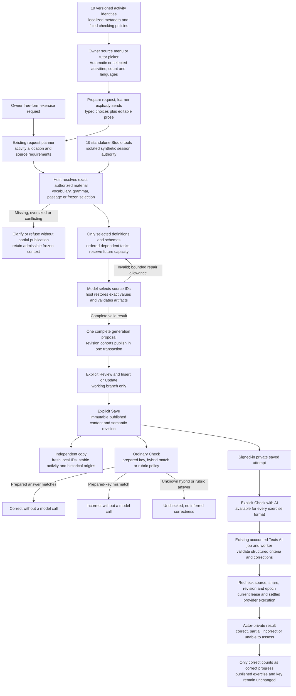

# Named text exercises

The shared catalog identifies 19 pedagogical activities independently from the
three rendering formats. This view follows their Knowledge authoring and practice
boundaries; it adds no provider, worker pool or publishing authority.

## Ownership and failure boundaries

The picker prepares a request; it does not send, generate or publish automatically.
Explicit activity/count choices must agree with editable prose, while Automatic
mode retains valid planner choices. Studio fixes one activity identity per tool;
the ordinary tutor actor still has four high-level learning-content tools.

Eligible sources are Knowledge vocabulary entries/senses, explicit grammar rules,
bilingual passages and exact selected prose. A source may also be an authorized
same-conversation proposal or a validated earlier task output. This is not a new
dependency on global Texts storage. Models supply bounded ID bindings; the host
captures the original values and provenance. Missing source, conflicting choices
or insufficient remaining capacity cannot produce a partly applicable proposal.
The parent action retains its five-provider-call/two-memory-call and output limits.

Local source IDs are validated against the current document and participate in
semantic revisions. Independent copies remap their local references; historical
proposal/selection origins stay frozen and never authorize another source read.
Published content contains no learner attempts or evaluation feedback. Cosmetic
edits preserve learning progress; substantive manual named edits require explicit
conversion to Custom, which deliberately omits named semantics. AI revision keeps
the original named identity and host-owned provenance.

Prepared matching normalizes NFC and whitespace while retaining case, accents,
punctuation and script. Anonymous prepared practice remains local; durable private
attempts and AI evaluation require the existing signed-in access. Explicit AI may
reconsider a private prepared result without changing its published key. Learning
outcomes are separate from job success/failure; partial and unassessed outcomes
do not become correct progress. Privacy and live-share revocation checks apply
again at publication, after provider settlement.

Deterministic tests establish contracts and execution wiring, not live-provider
pedagogical quality. See [Conversations and Knowledge](conversations-and-knowledge.md)
for the surrounding workspace, [AI lifecycle](ai-job-lifecycle.md) for accounting,
and [the workbook guide](../user-flows/interactive-workbooks.md) for verified journeys.

## Sources

- [Catalog and policies](../../packages/contracts/src/exercise-activity-catalog.ts).
- [Named semantics and frozen provenance](../../packages/contracts/src/named-exercises.ts).
- [Picker projection](../../apps/web/src/fsd/features/knowledge-notes/lib/exercise-generation.ts).
- [Exact source resolution](../../apps/backend/src/modules/conversations/infrastructure/ai/exercise-source-resolution.ts).
- [Selected-only authoring](../../apps/backend/src/modules/conversations/infrastructure/ai/learning-content-authoring.ts).
- [Atomic proposal publication](../../apps/backend/src/modules/conversations/infrastructure/persistence/drizzle/conversation-block-proposals.ts).
- [Prepared matching](../../apps/web/src/fsd/entities/learning-blocks/lib/check-prepared-answer.ts).
- [Fenced private feedback publication](../../apps/backend/src/modules/knowledge/infrastructure/persistence/drizzle/exercise-evaluation-source.sql).
- [ADR-0058](../adr/0058-named-activity-content-and-source-provenance.md).
