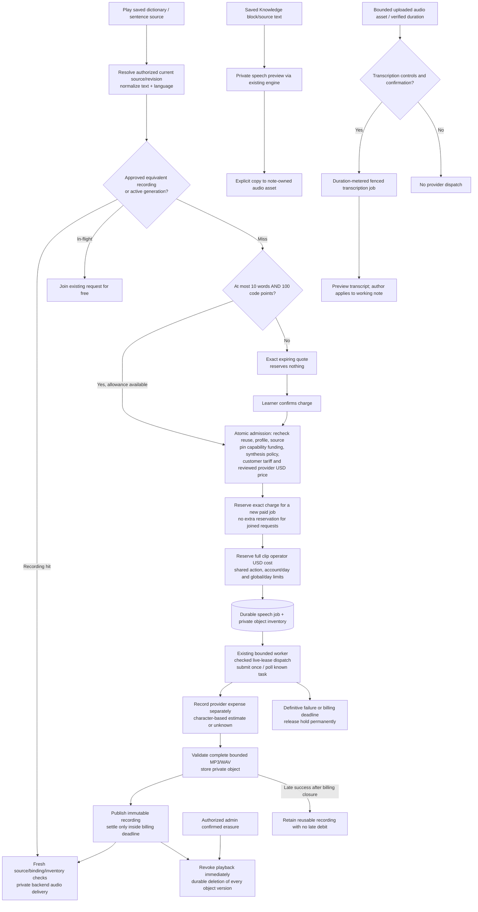

# Speech reuse, generation and pricing

Saved-source authorization precedes shared recording reuse or confirmed generation with success-only settlement.

Recording reuse precedes today's default model selection. The first new paid
admission pays; cache hits and joined requests are free. Exhausted short-text free
allowance rejects a new admission rather than silently charging. Credits use the
same ledger as text work, but speech only settles after validated audio publication.
Quotes expire after five minutes; billing closes ten minutes after admission.
Known task recovery and retained late output do not reopen billing.

Capability policy can fund speech for the operator; existing conditional short-text
exemptions and unlimited accounts remain. Every new clip still needs reviewed provider
pricing and sufficient operator USD authorization, including free/unlimited work. Speech
is indivisible: an operator allowance too small for the full clip rejects admission.
Dispatch checks the current speech lease and billing/execution deadlines through the
restricted financial entry point. Provider expense is separate from the customer character tariff and remains visible
for failures or late output; character-derived cost is labelled estimated and ambiguous
upstream usage is unknown. Existing daily admission counters provide an additional
free-count and estimated-unit bound. Shared operator budgets span speech and text work.

Source/account removal revokes bindings and associations. Successful normalized
text/audio remains retained under ADR-0031, including text that may contain personal
data; retention is not an anonymization claim. Admin erasure handles object versions.
Provider URLs and canonical identities stay private. Standard development storage
is private versioned MinIO; fixtures are deterministic and do not prove pronunciation
quality. ADR-0040 retires the former owner-scoped dictionary-audio HTTP protocol, worker,
client feature and one-time migration command. Shared speech is the current path.
`SPEECH_PLAYBACK_ENABLED` and `SPEECH_GENERATION_ENABLED` gate it; retained
`DICTIONARY_AUDIO_*` names configure its current provider/storage/profile/budgets
and are not evidence of an executable old protocol.

Migration 0074 locks and refuses nonempty old inventory before dropping the three
obsolete assets/jobs/bindings tables. The physical `dictionary_audio_blobs` byte
table remains owned by speech for the live PostgreSQL test-storage adapter; its
name does not make the stored references obsolete. No remote-object deletion is
implied. Current retained key/provider/storage configuration protects pending
tasks and reusable recordings.

Knowledge narration supplies source-bound private previews through the existing speech
engine, then explicitly copies accepted bytes into a note-owned audio grant. It is not a
global arbitrary-text synthesis endpoint. Uploaded Knowledge audio uses a separate
transcription path: verified source duration is a native meter, distinct from token or
character accounting. Dispatch is fail-closed until code-owned processing controls,
reviewed pricing/tariff, bounded confirmation, a live worker observation and current
source/lease authority all exist. A usable transcript can have unknown provider expense;
late/cancelled work cannot publish it. Remote video playback is outside this processing
path and does not imply transcript acquisition.

The worker coordinator now alternates dictionary generation with shared speech and, when
enabled, transcription.

## Sources

- [apps/backend/src/modules/speech/application/speech-service.ts](../../apps/backend/src/modules/speech/application/speech-service.ts)
- [apps/backend/src/modules/speech/application/speech-worker.ts](../../apps/backend/src/modules/speech/application/speech-worker.ts)
- [apps/backend/src/modules/speech/infrastructure/composition.ts](../../apps/backend/src/modules/speech/infrastructure/composition.ts)
- [apps/backend/src/modules/speech/infrastructure/drizzle-speech-store.ts](../../apps/backend/src/modules/speech/infrastructure/drizzle-speech-store.ts)
- [apps/backend/src/modules/ai-credits/application/ai-credit-participant.ts](../../apps/backend/src/modules/ai-credits/application/ai-credit-participant.ts)
- [apps/backend/src/modules/speech/infrastructure/audio/speech-provider-registry.ts](../../apps/backend/src/modules/speech/infrastructure/audio/speech-provider-registry.ts)
- [apps/backend/src/infrastructure/worker/dictionary-worker-command.ts](../../apps/backend/src/infrastructure/worker/dictionary-worker-command.ts)
- [compose.yaml](../../compose.yaml)
- [docs/adr/0031-shared-pronunciation-and-retained-recordings.md](../../docs/adr/0031-shared-pronunciation-and-retained-recordings.md)
- [docs/adr/0032-model-price-revisions-and-speech-settlement.md](../../docs/adr/0032-model-price-revisions-and-speech-settlement.md)
- [docs/adr/0034-speech-model-adapter-registration.md](../../docs/adr/0034-speech-model-adapter-registration.md)
- [apps/web/src/fsd/features/speech-playback/api/speech-api.ts](../../apps/web/src/fsd/features/speech-playback/api/speech-api.ts)
- [apps/backend/src/modules/speech/domain/speech-policy.ts](../../apps/backend/src/modules/speech/domain/speech-policy.ts)
- [docs/adr/0040-preproduction-owner-scoped-audio-retirement.md](../../docs/adr/0040-preproduction-owner-scoped-audio-retirement.md)
- [apps/backend/drizzle/0074_retire_dictionary_audio.sql](../../apps/backend/drizzle/0074_retire_dictionary_audio.sql)
- [apps/backend/src/modules/speech/infrastructure/blob-schema.ts](../../apps/backend/src/modules/speech/infrastructure/blob-schema.ts)
- [apps/backend/src/modules/speech/infrastructure/audio/dictionary-audio-environment.ts](../../apps/backend/src/modules/speech/infrastructure/audio/dictionary-audio-environment.ts)
- [apps/backend/src/modules/speech/infrastructure/audio/dictionary-audio-adapters.ts](../../apps/backend/src/modules/speech/infrastructure/audio/dictionary-audio-adapters.ts)
- [apps/backend/src/modules/speech/infrastructure/audio/dictionary-audio-budget.ts](../../apps/backend/src/modules/speech/infrastructure/audio/dictionary-audio-budget.ts)

- [docs/adr/0045-action-accounting-and-provider-expenses.md](../adr/0045-action-accounting-and-provider-expenses.md)

- [apps/backend/src/modules/speech/infrastructure/speech-accounting.ts](../../apps/backend/src/modules/speech/infrastructure/speech-accounting.ts)

- [apps/backend/src/modules/ai-credits/infrastructure/persistence/drizzle/drizzle-operator-budget-participant.ts](../../apps/backend/src/modules/ai-credits/infrastructure/persistence/drizzle/drizzle-operator-budget-participant.ts)

- [apps/backend/src/modules/ai-credits/infrastructure/persistence/drizzle/worker-financial-authority.sql](../../apps/backend/src/modules/ai-credits/infrastructure/persistence/drizzle/worker-financial-authority.sql)
- [apps/backend/src/modules/speech/infrastructure/knowledge-speech-lifecycle.ts](../../apps/backend/src/modules/speech/infrastructure/knowledge-speech-lifecycle.ts)
- [apps/backend/src/modules/knowledge/application/transcription-job-service.ts](../../apps/backend/src/modules/knowledge/application/transcription-job-service.ts)
- [apps/backend/src/modules/knowledge/infrastructure/transcription-job-composition.ts](../../apps/backend/src/modules/knowledge/infrastructure/transcription-job-composition.ts)
- [apps/backend/src/modules/knowledge/infrastructure/transcription-worker-readiness.ts](../../apps/backend/src/modules/knowledge/infrastructure/transcription-worker-readiness.ts)
- [docs/adr/0050-interactive-workbook-content-and-learning-boundaries.md](../adr/0050-interactive-workbook-content-and-learning-boundaries.md)
