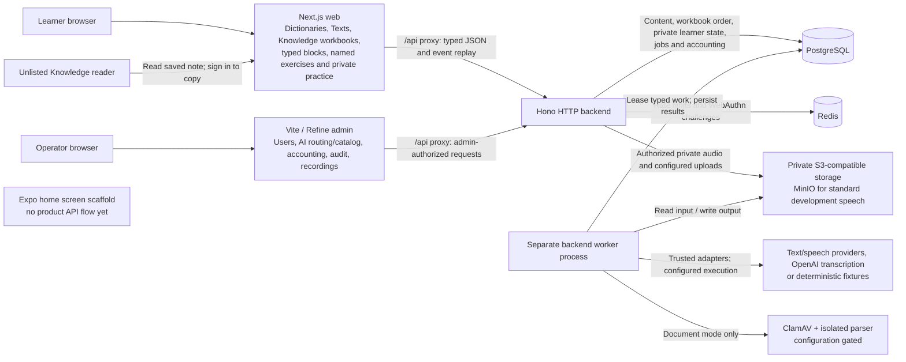

# System context

Applications, durable state and external services in the implemented development system.

The speech module now owns the sole executable pronunciation protocol; the former
owner-scoped dictionary audio routes/worker/client are retired under ADR-0040.
Current speech storage and provider configuration still uses `DICTIONARY_AUDIO_*`
names. Read [AI job lifecycle](ai-job-lifecycle.md) for the asynchronous boundary and
[development and deployment](development-and-deployment.md) for runtime topology.
This is an implementation map, not a claim that every flag or external service is
currently enabled. The user confirms the project has no production deployment.
The unlisted Knowledge reader reaches the same web/backend processes. The
fragment capability becomes a header on saved-note/workbook read and copy
requests; it does not expose the owner's working branches, learner history or
private conversations. Workbook order and private attempts are durable PostgreSQL
state. Private translations are actor overlays over saved source segments and use
the existing Texts execution path; they do not mutate the shared note.

Uploaded audio is stored as a note-granted immutable asset. The worker's dedicated
transcription lane is present only when its configuration, processing approval,
worker observation and credentials all admit it; a provider key by itself does
not enable processing. Remote video remains browser playback only.

**Reconciliation:** document storage, scanner and sandbox parser adapters are
implemented and configuration gated, as described in `docs/architecture.md`.
Adapter existence does not establish activation or external-service health.
The mobile source renders a static home screen and does not implement the browser
journeys shown here.

The admin also exposes accounting: manual payment/refund and provider funding records,
versioned prices/policies and USD reports. These use the same backend and PostgreSQL;
Feature052 introduces no external billing service, checkout or message broker.

The worker document-adapter helper retains the configured deterministic or
production adapter selection; it adds no process, storage service or external
provider. Knowledge HTTP error mapping remains within the same authenticated
and capability-aware router. These local readability changes leave the system
relationships shown above unchanged.

Named text exercises are Knowledge content, not another service or AI provider.
The shared catalog supplies 19 identities and policies; host-grounded generation
and actor-private checking reuse the existing Conversations, Knowledge and Texts
AI execution boundaries. The admin AI catalog is read only. See the
[named-exercise flow](named-exercises.md) for explicit publication and checking.

## Sources

- [docs/adr/0042-knowledge-workspace-document-and-context-boundaries.md](../adr/0042-knowledge-workspace-document-and-context-boundaries.md)
- [apps/web/src/fsd/pages/knowledge/ui/shared-knowledge-page/shared-knowledge-page.tsx](../../apps/web/src/fsd/pages/knowledge/ui/shared-knowledge-page/shared-knowledge-page.tsx)
- [apps/backend/src/modules/knowledge/interface/http/knowledge.routes.ts](../../apps/backend/src/modules/knowledge/interface/http/knowledge.routes.ts)
- [apps/backend/src/index.ts](../../apps/backend/src/index.ts)
- [apps/backend/src/app.ts](../../apps/backend/src/app.ts)
- [apps/backend/src/infrastructure/worker/dictionary-worker-command.ts](../../apps/backend/src/infrastructure/worker/dictionary-worker-command.ts)
- [apps/backend/src/modules/authentication/infrastructure/authentication-composition.ts](../../apps/backend/src/modules/authentication/infrastructure/authentication-composition.ts)
- [apps/web/next.config.mjs](../../apps/web/next.config.mjs)
- [apps/admin/vite.config.ts](../../apps/admin/vite.config.ts)
- [apps/mobile/src/screens/home-screen.tsx](../../apps/mobile/src/screens/home-screen.tsx)
- [compose.yaml](../../compose.yaml)
- [docs/architecture.md](../../docs/architecture.md)
- [docs/adr/0040-preproduction-owner-scoped-audio-retirement.md](../../docs/adr/0040-preproduction-owner-scoped-audio-retirement.md)
- [apps/backend/src/modules/speech/infrastructure/composition.ts](../../apps/backend/src/modules/speech/infrastructure/composition.ts)

- [docs/adr/0045-action-accounting-and-provider-expenses.md](../adr/0045-action-accounting-and-provider-expenses.md)
- [docs/adr/0050-interactive-workbook-content-and-learning-boundaries.md](../adr/0050-interactive-workbook-content-and-learning-boundaries.md)
- [apps/backend/src/modules/knowledge/interface/http/workbook.routes.ts](../../apps/backend/src/modules/knowledge/interface/http/workbook.routes.ts)
- [apps/backend/src/modules/knowledge/interface/http/transcription-job-routes.ts](../../apps/backend/src/modules/knowledge/interface/http/transcription-job-routes.ts)
- [apps/backend/src/modules/knowledge/application/private-translation-service.ts](../../apps/backend/src/modules/knowledge/application/private-translation-service.ts)
