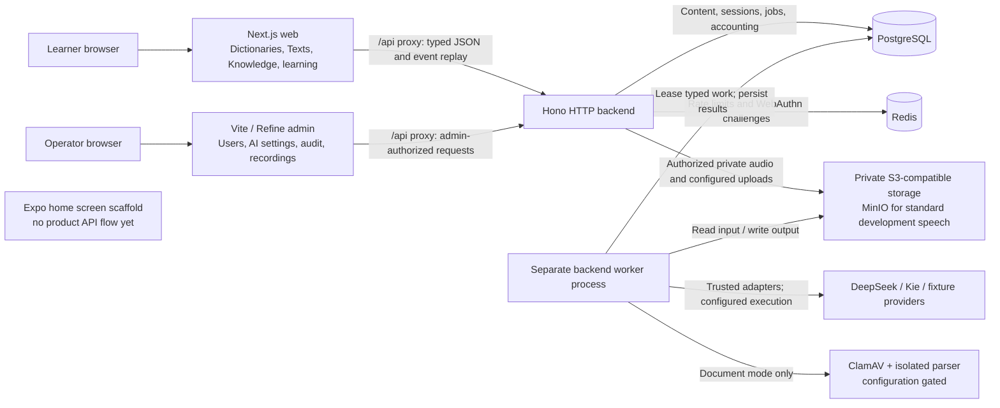

# System context

Applications, durable state and external services in the implemented development system.

The speech module now owns the sole executable pronunciation protocol; the former
owner-scoped dictionary audio routes/worker/client are retired under ADR-0040.
Current speech storage and provider configuration still uses `DICTIONARY_AUDIO_*`
names. Read [AI job lifecycle](ai-job-lifecycle.md) for the asynchronous boundary and
[development and deployment](development-and-deployment.md) for runtime topology.
This is an implementation map, not a claim that every flag or external service is
currently enabled. The user confirms the project has no production deployment.

**Reconciliation:** the opening sketch and backend paragraph in `docs/architecture.md`
still call document storage/scanning/parsing planned. The worker command already
composes S3 storage, ClamAV and a sandbox parser when document mode is configured.
Those adapters exist; activation and external-service health remain separate facts.
The mobile source renders a static home screen and does not implement the browser
journeys shown here.

## Sources

- [apps/backend/src/index.ts](../../apps/backend/src/index.ts)
- [apps/backend/src/app.ts](../../apps/backend/src/app.ts)
- [apps/backend/src/infrastructure/worker/dictionary-worker-command.ts](../../apps/backend/src/infrastructure/worker/dictionary-worker-command.ts)
- [apps/backend/src/modules/authentication/infrastructure/authentication-composition.ts](../../apps/backend/src/modules/authentication/infrastructure/authentication-composition.ts)
- [apps/web/next.config.mjs](../../apps/web/next.config.mjs)
- [apps/admin/vite.config.ts](../../apps/admin/vite.config.ts)
- [apps/mobile/src/screens/home-screen.tsx](../../apps/mobile/src/screens/home-screen.tsx)
- [compose.yaml](../../compose.yaml)
- [docs/architecture.md](../../docs/architecture.md)
- [docs/adr/0040-preproduction-owner-scoped-audio-retirement.md](../../docs/adr/0040-preproduction-owner-scoped-audio-retirement.md)
- [apps/backend/src/modules/speech/infrastructure/composition.ts](../../apps/backend/src/modules/speech/infrastructure/composition.ts)
