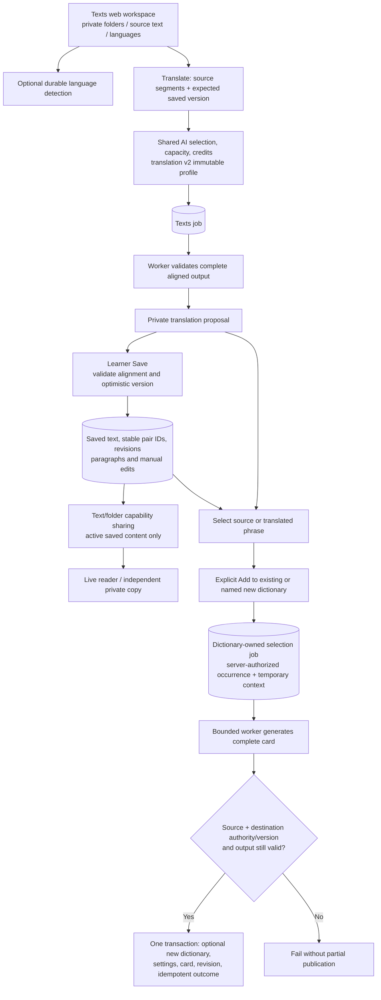

# Texts and contextual vocabulary

Translation becomes saved aligned text only on Save; selected-phrase Add authorizes atomic dictionary publication.

The content module always composes its routes; new detection/translation/selection
admissions additionally require `TEXTS_AI_ENABLED=true` and, for deployed modes,
compatible API/worker format declarations. A flag is not proof the external model
is configured. The source length bound does not guarantee model capacity; complete
preflight can reject without truncation or silent fallback.

Save preserves bounded sentence alignment and manual provenance. Vocabulary Add
already authorizes publication, so completion does not wait for a browser Accept.
Source occurrence context is temporary job input, distinct from the short persistent
dictionary semantic hint. Revoked/archived source access prevents pending publication;
already completed independent copies and cards survive under their own ownership.

**Reconciliation:** ADR-0035's context says frontend waits for design; it describes
that decision's implementation phase. Current route/page and workspace-hook code
implements Texts UI. The diagram reflects that code without rewriting ADR history.

New selected Texts and dictionary-selection jobs join shared action accounting with pinned
customer/provider prices, bounded output and operator budgets. Invalid or technically failed
results do not charge learners; provider expense remains separate. This changes financial
settlement, not the explicit Save/Add publication edges. See [AI job lifecycle](ai-job-lifecycle.md).

## Sources

- [apps/backend/src/modules/texts/infrastructure/texts-composition.ts](../../apps/backend/src/modules/texts/infrastructure/texts-composition.ts)
- [apps/backend/src/modules/texts/application/texts-job-service.ts](../../apps/backend/src/modules/texts/application/texts-job-service.ts)
- [apps/backend/src/modules/texts/application/texts-worker-service.ts](../../apps/backend/src/modules/texts/application/texts-worker-service.ts)
- [apps/backend/src/modules/texts/infrastructure/persistence/drizzle/drizzle-text-content-store.ts](../../apps/backend/src/modules/texts/infrastructure/persistence/drizzle/drizzle-text-content-store.ts)
- [apps/backend/src/modules/dictionaries/infrastructure/text-selection-composition.ts](../../apps/backend/src/modules/dictionaries/infrastructure/text-selection-composition.ts)
- [apps/backend/src/modules/dictionaries/infrastructure/persistence/drizzle/text-selection-source.ts](../../apps/backend/src/modules/dictionaries/infrastructure/persistence/drizzle/text-selection-source.ts)
- [apps/backend/src/modules/dictionaries/infrastructure/persistence/drizzle/text-selection-target.ts](../../apps/backend/src/modules/dictionaries/infrastructure/persistence/drizzle/text-selection-target.ts)
- [apps/web/src/fsd/pages/texts/hooks/use-text-workspace-session.ts](../../apps/web/src/fsd/pages/texts/hooks/use-text-workspace-session.ts)
- [apps/backend/src/modules/text-ai/infrastructure/text-ai-composition.ts](../../apps/backend/src/modules/text-ai/infrastructure/text-ai-composition.ts)
- [docs/adr/0035-texts-and-contextual-vocabulary-publication.md](../../docs/adr/0035-texts-and-contextual-vocabulary-publication.md)
- [docs/adr/0036-task-specific-text-translation-capacity.md](../../docs/adr/0036-task-specific-text-translation-capacity.md)
- [apps/web/src/fsd/entities/texts/api/jobs.ts](../../apps/web/src/fsd/entities/texts/api/jobs.ts)
- [apps/backend/tests/unit/modules/texts/texts-worker.test.ts](../../apps/backend/tests/unit/modules/texts/texts-worker.test.ts)

- [docs/adr/0045-action-accounting-and-provider-expenses.md](../adr/0045-action-accounting-and-provider-expenses.md)

- [apps/backend/src/modules/ai-credits/infrastructure/persistence/drizzle/legacy-action-accounting.ts](../../apps/backend/src/modules/ai-credits/infrastructure/persistence/drizzle/legacy-action-accounting.ts)

- [apps/backend/src/modules/texts/infrastructure/persistence/drizzle/drizzle-texts-job-store.ts](../../apps/backend/src/modules/texts/infrastructure/persistence/drizzle/drizzle-texts-job-store.ts)

- [apps/backend/src/modules/dictionaries/infrastructure/persistence/drizzle/drizzle-text-selection-store.ts](../../apps/backend/src/modules/dictionaries/infrastructure/persistence/drizzle/drizzle-text-selection-store.ts)
