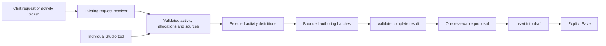

# Named exercise tools, verification, and Mastra playground

This plan records the decisions agreed on 2026-11-12. The user authorized saving
the plan and implementing **Feature 1, Tutor and learning-tool playground —
BL-014**, first. After its verified delivery and operating instructions, the user
will check the playground before exercise implementation continues. Features 2
and 3 and the later extensions remain deferred; this document does not authorize
starting them. Actual delivery state and evidence belong in the corresponding
feature records and backlog, not this roadmap.

## 1. Delivery order and architectural decisions

Deliver this as separate features:

| Order                                     | Feature                                         | Result                                                                                                            |
| ----------------------------------------- | ----------------------------------------------- | ----------------------------------------------------------------------------------------------------------------- |
| 1 — completed; awaiting user check        | **Tutor and learning-tool playground — BL-014** | Test current tools and complete tutor turns in isolated Mastra Studio sessions.                                   |
| 2 — deferred until user checks playground | **Named text exercises**                        | Deliver 19 priority activities through chat, an activity picker, interactive blocks, answer checking, and Studio. |
| 3 — deferred                              | **Additional text activities**                  | Add the remaining nine text activities and their required interactions.                                           |
| Later — deferred                          | **Answer-aware chat references**                | Attach specific attempts to chat and compare answers across exercises.                                            |
| Later — deferred                          | **Listening and speaking**                      | Separate work covering audio prerequisites, recording, transcription, and assessment.                             |

Use the [exercise research](surveys/language-learning-exercise-catalog.md) as the
pedagogical specification.

**One tool per named activity is appropriate, but those tools must not all enter
the tutor's context.**

Each activity gets a canonical tool, such as `generate_recall_word`, backed by a
shared activity definition and generation pipeline. Studio exposes these tools
individually. Production uses the existing request resolver to select activities
from compact metadata, then loads only the selected generation instructions and
schemas.

Mastra supports request-dependent tools, per-run toolsets, and per-step tool
filtering. The installed version supports these mechanisms, but the initial
implementation does not need another routing agent or model-driven tool
discovery. References: [request context](https://mastra.ai/docs/server/request-context),
[execution options](https://mastra.ai/reference/streaming/agents/stream), and
[per-step processors](https://mastra.ai/reference/processors/processor-interface).



A tool represents an **activity type**, not an individual question. One invocation
can generate several questions. A mixed request uses one coordinated operation;
it must not loop through tools that independently publish proposals.

## 2. Feature 1 — Complete the isolated playground first

Extend [BL-014](backlog/014-tutor-playground-done.md). The repository already contains
playground provisioning and a generic verification harness; the missing feature
is integration with the real tutor and learning-content operations.

### P1 — Compose the production execution path

- Reuse production tutor, request resolver, authoring, validation, memory, and publication factories.
- Supply server-created synthetic identity, authorized fixture sources, operation budgets, cancellation, and persistence callbacks.
- Create fresh execution state for every invocation. Never share a tool closure containing another run's signal, remaining budget, or publication state.
- Keep execution in the playground process and isolated database; do not start the normal web/admin application.

### P2 — Expose faithful tutor testing as a workflow

Register `run-tutor-turn` with these conceptual interfaces:

```ts
input: {
    scenarioId: string;
    sessionId?: string;
    message: string;
}

output: {
    sessionId: string;
    turnId: string;
    response: string;
    proposals: ProposalReceipt[];
    diagnostics: SyntheticRunDiagnostics;
}
```

The workflow submits and processes a real synthetic conversation turn through
the existing application worker and runner. It must not manufacture worker leases
or bypass publication/accounting callbacks.

Repeating the workflow with the same session exercises clarification and
follow-up requests. Persist messages, request state, and proposals in the
playground's application tables. Workflow execution history itself can remain
ephemeral.

Native Studio agent chat is deferred: calling the base agent directly would
bypass part of Languon's orchestration.

### P3 — Expose individual tools and result inspection

- Register the current vocabulary, grammar, bilingual-text, and exercise tools through canonical composition.
- Invoke them through a synthetic execution adapter with the same source and budget checks.
- Provide authorized proposal readback: compact receipts alone are insufficient for inspecting generated blocks.
- Show bounded synthetic diagnostics: resolved request, selected tools/tasks, model inputs, validation failures, call counts, and output.
- Keep diagnostic capture local to the run; preserve production logging redaction.

### P4 — Supply reproducible scenarios

Include empty owned document, vocabulary-to-exercises, grammar revision, missing
language, ambiguous request, mixed generation, and read-only source.

Ordinary restarts preserve sessions. Starting a scenario afresh creates a new
session; the existing guarded reset clears only the playground database.

Serialize executions initially to avoid shared-worker claim ambiguity. Align
workflow/server timeouts with the bounded tutor deadline, and propagate
cancellation through generation and persistence.

### P5 — Preserve execution restrictions

Allow only registered workflows/tools and validated scenario/session selectors.
Reject arbitrary identities, source authority, model/prompt/tool overrides, and
generic model proxies.

Deterministic execution is the default. Optional live execution must use
deliberately configured development credentials, an authorized route, and
enforced spending limits. Studio must not become a bypass around those limits.

**Completion gate:** a real Studio session can generate vocabulary, inspect the
proposal, then generate exercises from that exact proposal using a second
workflow invocation. Independent tool execution, session isolation, restart
persistence, cancellation, and guarded reset must also pass.

Provide verified instructions for starting the playground, running each tool,
testing workflow sessions, inspecting results, handling failures, and resetting
fixtures. Hand the playground to the user for checking before Feature 2 begins.

## 3. Feature 2 — Deliver the 19 priority text activities

### E1 — Establish the activity catalog and contracts

Separate these concepts:

| Concept         | Responsibility                                         |
| --------------- | ------------------------------------------------------ |
| Activity        | Pedagogical task selected by the learner.              |
| Format          | Interaction: choice, gaps, or text response initially. |
| Exercise        | One independently answerable block.                    |
| Exercise set    | Presentation group containing individual exercises.    |
| Checking policy | Prepared key, hybrid acceptance, or AI rubric.         |

Create SDK-independent catalog metadata with stable activity ID/version,
localized name and description, example, supported source kinds, format, and
checking policy.

Keep detailed generation rules, validators, and Mastra adapters in backend
infrastructure. Client bundles receive display metadata, not generation prompts.

Extend named exercise content with objective, activity identity, checking policy,
structured key/rubric, and source provenance. Preserve a genuine **Custom
exercise** path for manual authoring.

Update the current contracts and consumers together. Named generated exercises
must not silently degrade into unnamed generic exercises.

### E2 — Implement the first catalog

**Key:** deterministic prepared answers. **Hybrid:** accept prepared valid
variants immediately; other answers await explicit AI checking. **AI:** evaluate
against a rubric after the learner requests it.

| ID  | Selectable activity             | Initial format and checking |
| --- | ------------------------------- | --------------------------- |
| V01 | Recall the word                 | Short text; hybrid          |
| V02 | Choose the meaning              | Choice; key                 |
| V03 | Complete the sentence           | Gaps; hybrid                |
| V05 | Build natural word pairs        | Gaps; hybrid                |
| V06 | Change the word form            | Gaps; constrained key       |
| V07 | Use these words                 | Text; AI                    |
| G01 | Choose the right form           | Choice; key                 |
| G02 | Complete the grammar            | Gaps; constrained key       |
| G03 | Rewrite with the target grammar | Text; hybrid                |
| G04 | Find and fix the error          | Edited sentence; hybrid     |
| G06 | Choose what the sentence means  | Choice; key                 |
| G07 | Say it for this situation       | Text; AI                    |
| R01 | Find the main idea              | Choice; key                 |
| R02 | Find the details                | Choice; key                 |
| R03 | True, false or not stated       | Three-way choice; key       |
| R04 | Answer in your own words        | Text; AI                    |
| R08 | Complete the summary            | Gaps; hybrid                |
| R09 | Summarize the text              | Text; AI                    |
| W01 | Translate the meaning           | Text; AI                    |

Every activity definition must specify generation inputs, expected output,
answer constraints, explanation requirements, and rejection cases. The checking
policy is controlled by the definition and validated constraints, not freely
chosen by the model.

For hybrid text activities, prepared variants are acceptance shortcuts—not
exhaustive lists of all correct answers.

### E3 — Implement tools and bounded selection

- Generate dedicated tool adapters from the activity registry. Each fixes its activity identity and accepts only relevant generation parameters.
- Keep their descriptions short; detailed pedagogy belongs in selected authoring instructions.
- Register every activity tool in Studio.
- Do not attach all activity tools to the conversational tutor. Preserve the compact high-level exercise capability there.
- Replace the current format-rotation request with explicit activity allocations: activity ID, count, and order.
- Nest allocations inside an exercise task, so selecting activities does not consume one top-level task per activity.
- Validate output against exact activity counts and formats, rather than the current round-robin format rule.

Explicit activity selections are requirements. If the text request contradicts
the picker, ask for clarification. If a selected activity lacks its prerequisite
source, report that prerequisite instead of silently substituting another
activity.

Automatic mode uses the existing resolver with compact eligible catalog
metadata. Default to five questions and choose by source and objective. Example
defaults:

- Vocabulary: meaning recognition, contextual completion, then recall.
- Grammar: meaning contrast, form completion, transformation, then situated use.
- Reading: main idea, details, an open question, and a summary.

These are product defaults, not claims of an optimal learning formula.

### E4 — Ground generation in exact material

Support existing blocks, selected text, authorized same-chat proposals, and newly
generated material within the same request.

For dependent requests such as “generate vocabulary and exercises for those
words”:

1. Represent the dependency using a server-owned task-output reference.
2. Generate and validate the vocabulary first.
3. Freeze its actual words and senses.
4. Generate dependent exercises from that validated result.
5. Publish the complete result once.

Apply the same sequence to grammar and reading material. Reject circular or
unresolved dependencies. The model must not invent source identities.

Extend provenance beyond the current passage-only references: vocabulary
exercises need selected entries/senses; grammar exercises need the targeted
rule; reading exercises need the exact passage and supporting evidence.

For text selections without stable passage IDs, retain an authorized frozen
excerpt and provenance. Source changes must affect the exercise's semantic
revision when they change its meaning or answer.

Validation must cover:

- Exact requested activities, counts, and target coverage.
- Valid references and remapping during insertion/copying.
- One defensible answer for single choice.
- Complete constrained keys and plausible distractors.
- Meaning preservation and target-form requirements for transformations.
- Supporting evidence for comprehension.
- An absence rationale for “not stated.”
- No answer leakage through questions or hints.

### E5 — Preserve budgets and atomic publication

Keep the existing limits: five provider calls total, at most two memory calls
within that total, aggregate output allowance, deadlines, and proposal limits.

Update capacity estimates for rubrics, accepted variants, and source evidence.
Reserve capacity for dependent tasks before starting them.

Reuse the existing bounded repair policy. Do not add a verifier agent or one
model call per exercise.

If the complete request cannot fit, return a useful limitation before generation
where possible. A later failure leaves no partial proposal. Apply and Save
remain explicit.

### E6 — Implement answer checking and explanatory feedback

Preserve the confirmed interaction: **AI checking runs only after “Check with
AI.”**

| Situation                                  | Result                                              |
| ------------------------------------------ | --------------------------------------------------- |
| Prepared key matches                       | Correct; no model call.                             |
| Constrained key does not match             | Incorrect, with prepared explanation.               |
| Hybrid answer is not recognized            | Unchecked; offer AI checking.                       |
| Open response is saved                     | Unchecked until AI evaluation completes.            |
| Provider fails or allowance is unavailable | Evaluation unavailable; answer is not marked wrong. |

Extend persisted evaluation contracts to support `correct`,
`partially-correct`, `incorrect`, `unchecked`, and `unable-to-assess`. Keep
queued/running/failed job states separate from learning outcomes.

Structured AI feedback should distinguish task completion, meaning/content,
target grammar or vocabulary use, relevant evidence, and one or two actionable
corrections. Partial and unassessed results must not count as correct in progress
calculations.

Use current NFC and whitespace normalization initially. Preserve meaningful
case, accents, punctuation, and script distinctions; explicitly authored variants
handle permitted alternatives. Do not introduce global fuzzy matching.

Prepared explanations should explain the answer and relevant distractors. AI
may recognize a valid alternative or identify a questionable key, but must not
silently modify the published exercise.

### E7 — Integrate the activity picker and editor

Add **Generate exercises** to eligible vocabulary, grammar, and text contexts,
plus the chat composer.

Use the existing dialog/side-panel patterns with:

- Source summary.
- Automatic mode or named activity selection.
- Count, language, and difficulty.
- Short descriptions and examples.
- Clear checking labels.

Default total count is five. Distribute it across explicitly selected activities
in selection order; require a larger count if there are more selected activities
than questions. Preserve explicitly requested per-activity counts.

Reuse the current choice, gap, and text renderers. Display activity names and
appropriate feedback without creating 19 separate widgets.

Keep Review → Insert → Save, manual editing, independent copying, anonymous
prepared practice, and private signed-in attempts working. Generated activity
semantics must remain valid after editing; authors can explicitly switch an
exercise to Custom when necessary.

## 4. Expansion and future chat references

**Feature 3 adds the remaining nine text activities:**

| Activities                                                     | Required addition                                                    |
| -------------------------------------------------------------- | -------------------------------------------------------------------- |
| V04 Match words and meanings; R05 Match headings to paragraphs | Matching interaction and mapping answers.                            |
| V08 Sort by meaning or use                                     | Category assignment with explicit single/multiple-category rules.    |
| G05 Put the sentence in order; R06 Reconstruct the sequence    | Ordering with repeated-token identities and valid-order constraints. |
| R07 Find evidence for the answer                               | Stable passage selection and evidence validation.                    |
| R10 Respond to the text; W02 Write a practical message         | New task-specific rubrics using the text renderer.                   |
| W03 Rewrite after feedback                                     | Explicit selection of a private prior attempt and its feedback.      |

Matching, sorting, ordering, and evidence selection need real answer contracts,
accessible controls, authoring support, and checking logic. They must not be
represented as instructions pasted into a generic text field.

W03 must use an authorized private attempt context. It must not embed a learner's
answer or feedback into shared authored content automatically. Its
private-context resolver can be reused by the later chat-reference feature.

**Prepare for answer-aware chat in Feature 2; implement its UI separately.**

Basic block mentions already exist, including multiple references. Preserve them.

The exercise feature must retain:

- Stable exercise identity and server-derived semantic revision.
- The exact exercise/source snapshot answered.
- Private attempt ID, response, evaluation, and relevant hint/reveal history.
- Ownership and deletion/revocation rules.

The later feature extends references to distinguish **block content** from **a
specific attempt**. The client supplies identities; the server resolves the
answer and feedback. It must never infer “latest attempt” when the learner
selected a historical one.

That later scope includes “Ask about this answer,” multiple-attempt comparisons,
mixed block/attempt chips, and historical-source disclosure. It must preserve
the existing reference/context limits and prevent authors from accessing
readers' private attempts.

## 5. Verification and completion gates

### Playground

Verify real Studio discovery and execution, canonical result readback,
multi-turn sessions, independent sessions, restart/reset behavior, cancellation,
and refusal of forged authority or execution overrides. Use disposable
persistence and an independent security review.

### Generation

For every activity, test valid generation and representative invalid outputs.
Cover explicit selection, automatic eligibility, count conflicts, missing
material, language requirements, mixed requests, dependent tasks, exact source
preservation, and failure after an earlier successful batch.

Assert that unselected activity schemas/instructions are absent from outgoing
authoring requests. Measure serialized context size and provider calls rather
than claiming unmeasured token savings.

### Checking and persistence

Cover valid alternatives, contradictions, wrong target forms, partial answers,
ambiguous keys, adversarial instructions, and multilingual normalization. Verify
idempotent attempts/evaluation, historical revisions, source edits/deletion,
shared-reader privacy, and late results after cancellation.

Update all contract, publication, projection, and UI consumers together. Any
necessary data migration must preserve the relationship between an attempt and
the content answered; no runtime legacy-format path is introduced.

### Application

Run the real browser journeys on desktop and narrow screens: choose activities
→ generate → review → insert → save → answer → prepared check/explicit AI
feedback → reload. Include keyboard access, manual edits, copies, shared
readers, and existing block mentions.

Use deterministic provider responses at the external boundary for automated
tests, while retaining real application authorization, worker, persistence, and
settlement paths. Report deterministic verification, local readiness, and any
separately authorized live proof independently.

Each feature receives its own specification, execution plan, evidence, review,
and backlog updates. Finish and verify the playground before starting the
exercise implementation, as requested. Audio, native Studio tutor chat, and
answer-aware chat UI remain separate deliveries.

## Playground delivery status

BL-014 is complete as feature065. See [playground usage](tutor-playground.md) and [verified evidence](../.agent/features/065-tutor-learning-tool-playground/EVIDENCE.md). The user will inspect the playground before exercise implementation starts. Live model testing still requires reviewed isolated routing/pricing/funding configuration; deterministic fixtures are immediately available.
