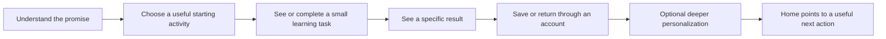

# Homepage, onboarding and learning motivation

## Recommendation and decision

Build toward **two home experiences with several learner states**:

- A public home that explains the learner benefit, demonstrates a concrete learning sequence, and makes starting obvious.
- A signed-in home that helps someone begin or continue useful learning. Adapt its main action for a new account, an active learner, and someone returning after an absence.

The proposed organizing idea is **“Your materials, a clear next step.”** A possible public headline is **“Turn what interests you into language practice.”** These are positioning hypotheses to test, not an established competitive advantage.

The home should connect Languon's capabilities into an understandable sequence: choose meaningful material → understand it → practise → return and build on it. Dictionaries, texts, notes, spaces and AI help are the supporting tools. The signed-in page should put the next activity above the statistics. Personalization should improve that activity without becoming the price of entry.

Respect the existing global navigation shell. Different content for guests and members does not require two separate navigation systems. Keep future agent-led lessons, courses and teacher workflows out of current availability claims.

This is a research proposal, not an approved visual design or implementation specification. No application code, runtime behavior, analytics collection or product permissions changed.

## Brief, assumptions and evidence limits

**Confirmed from the request:** make the home more attractive and useful; consider public and authenticated experiences; use existing dictionaries, texts, notes/spaces, personalization, AI chat and exercises; consider motivation and statistics; allow for future agent-led lessons/courses and teacher-created shared lessons.

**Confirmed audience:** the user selected independent adult language learners as the primary audience. This survey treats teacher-led use as a future extension. A beginner who needs a complete curriculum and an intermediate learner bringing their own material have different needs; the homepage must not promise the former if only the latter is available. Desktop and mobile web both matter. No monetization, language-support coverage, customer traction or target acquisition channel is assumed.

Research combines current repository source/contracts, accepted product decisions, official competitor pages/documentation, academic papers or abstracts, and practitioner UX guidance. It is a targeted decision survey, not an exhaustive systematic literature review. Competitor documentation describes intended behavior; it is not hands-on testing of authenticated interfaces. Some academic findings were available only as publisher/author abstracts. Local runtime was not exercised. No Languon conversion baseline, interviews, usability sessions or learning-outcome data were supplied.

Consequently, evidence supports principles and testable hypotheses; it does not establish an optimal page, a conversion uplift, a universal ideal onboarding length, or a proven retention benefit for Languon. Research date means sources were checked on that date, not that all studies or documented interfaces are new.

## Current application: what the redesign must respect

| Verified source finding                                                                                                                                                                                                                                                                   | Product implication                                                                                                                                                                             |
| ----------------------------------------------------------------------------------------------------------------------------------------------------------------------------------------------------------------------------------------------------------------------------------------- | ----------------------------------------------------------------------------------------------------------------------------------------------------------------------------------------------- |
| [HomePage](../../apps/web/src/fsd/pages/home/ui/home-page/home-page.tsx) shows a date, “Welcome back” and the portrait card. [PortraitEntryCard](../../apps/web/src/fsd/features/portrait-entry/ui/portrait-entry-card/portrait-entry-card.tsx) renders nothing for guests.               | The current guest main content does not explain the product or offer a learning CTA. The signed-in main task is personalization setup. The problem is purpose and action as well as appearance. |
| [ADR-0030](../adr/0030-global-web-shell-and-preference-placement.md) requires the same session-aware sidebar/rail/mobile drawer across normal public and private pages.                                                                                                                   | Design the proposed public page inside that shell. A separate conventional marketing header would revisit an explicit product decision and require a successor decision.                        |
| [Navigation summaries](../../packages/contracts/src/navigation.ts) include resource titles, links, pins and last-opened timestamps for dictionaries, texts and Knowledge.                                                                                                                 | Reopening recent material is a credible near-term home action. “Continue” must mean reopening the resource unless an exact saved position is separately supported.                              |
| [Flashcard totals](../../packages/contracts/src/learning/index.ts) expose known, again, unstudied and total. [The guide](../user-flows/flashcard-training-web.md) explicitly distinguishes self-assessment from accuracy and spaced repetition.                                           | “Marked known” is truthful. “Words mastered,” “accuracy” and “due today” are not interchangeable labels. Queues/manual subsets do not resume across reload.                                     |
| [Sentence practice contracts](../../packages/contracts/src/learning/sentences.ts) distinguish assisted checks, manual review and graded outcomes.                                                                                                                                         | Show results in their own context; do not collapse unlike measures into a universal learning score.                                                                                             |
| [ADR-0044](../adr/0044-learner-portrait-approval-and-use-boundaries.md) separates portrait drafting, approval and permission to use it.                                                                                                                                                   | Preserve optional/manual setup and explicit enablement. An interview answer is not consent to publish a portrait or use it across conversations.                                                |
| [Workbook learning contracts](../../packages/contracts/src/workbook-learning.ts) already represent attempts, feedback, reveals and explicit note completion. [ADR-0050](../adr/0050-interactive-workbook-content-and-learning-boundaries.md) keeps learner activity private from authors. | Interactive content provides a foundation; it does not establish agent-led course progression or teacher access to student results.                                                             |

The [interactive-workbooks feature](../../.agent/features/059-interactive-workbooks/FEATURE.md) remains “In progress,” while its [guide](../user-flows/interactive-workbooks.md) mixes current metadata with residual pending/draft prose. Treat that as a readiness/documentation uncertainty. Do not advertise the entire feature as finished on the strength of schema presence. Exact supported languages, speech availability and AI charges also need release-specific verification before appearing in marketing.

The scoped audit did not establish a global weekly-learning dashboard, reliable study-time totals, a streak contract, spaced-review scheduling or proficiency measurement. Existing timestamps do not prove those experiences are ready to expose.

## Evidence that should shape the page

Each application below is our design inference, not the measured outcome of a Languon experiment.

| Evidence                                                                                                                                                                                                                             | What it supports                                                                                                                       | Boundary and application                                                                                                                                   |
| ------------------------------------------------------------------------------------------------------------------------------------------------------------------------------------------------------------------------------------ | -------------------------------------------------------------------------------------------------------------------------------------- | ---------------------------------------------------------------------------------------------------------------------------------------------------------- |
| [NN/g: Homepage Design, 2024](https://www.nngroup.com/articles/homepage-design-principles/)                                                                                                                                          | Communicate purpose, show representative content and make actions apparent.                                                            | Practitioner guidance, not a promised conversion lift. Demonstrate one learning example instead of greeting guests or listing every tool.                  |
| [NN/g: Onboarding Tutorials, 2023](https://www.nngroup.com/articles/onboarding-tutorials/)                                                                                                                                           | Contextual assistance often serves tasks better than introductory tours that users skip or forget.                                     | Novel interactions can still need instruction. Teach saving a word when the learner encounters one; defer a tour of spaces and settings.                   |
| [Howard et al., 2021](https://journals.sagepub.com/doi/abs/10.1177/1745691620966789), motivation meta-analysis, 344 samples                                                                                                          | Interest and personally valuing learning are associated with beneficial outcomes; controlled motivation has a different pattern.       | Association is not homepage causation. Connect tasks to the learner's own purpose rather than making points the entire proposition.                        |
| [Wang et al., 2024](https://selfdeterminationtheory.org/wp-content/uploads/2024/06/2024_WangWangEtAl_MetaEdu.pdf), educational intervention meta-analysis                                                                            | Evidence supports autonomy/competence and, in experimental subsets, intrinsic motivation.                                              | Mixed educational settings limit transfer. Offer a recommendation with an understandable alternative and adjustable pace.                                  |
| [Harkin et al., 2016](https://eprints.whiterose.ac.uk/id/eprint/91437/), 138 randomized studies                                                                                                                                      | Goal-progress monitoring improved attainment on average, with an effect size of d = .40.                                               | This supports purposeful monitoring, not every dashboard. Show progress toward a chosen goal and link it to an action.                                     |
| [Kaliisa et al., 2024](https://arxiv.org/abs/2312.15042), 38-study dashboard review                                                                                                                                                  | Achievement evidence was limited; participation findings were more promising. Studies often had selection and measurement limitations. | A wall of graphs is not an educational intervention by itself. Put an actionable summary below the learning entry.                                         |
| [Silverman and Barasch, 2023](https://doi.org/10.1093/jcr/ucac029), seven streak studies; [institutional summary](https://www.insead.edu/faculty-research/publications/journal-articles/or-track-how-broken-streaks-affect-consumer) | Framing a logged streak as intact or broken affects subsequent engagement; repair opportunities moderate the effect.                   | Engagement is not language learning. Preserve cumulative progress and make returning after a break welcoming.                                              |
| [Sailer and Homner, 2020](https://link.springer.com/article/10.1007/s10648-019-09498-w), gamification meta-analysis                                                                                                                  | Positive average cognitive, motivational and behavioral effects, with variation and weaker robustness for some outcomes.               | Does not prescribe leaderboards, badges or XP. Test modest milestones before introducing a reward economy.                                                 |
| [Agarwal et al., 2021](https://link.springer.com/article/10.1007/s10648-021-09595-9), 50 retrieval experiments                                                                                                                       | Answer-producing retrieval benefits learning across many classroom contexts.                                                           | Geographic coverage and transfer to specific app exercises are limited. Give practice a clear home entry; generated questions still need quality checks.   |
| [Kim and Webb, 2022](https://onlinelibrary.wiley.com/doi/abs/10.1111/lang.12479), 48 second-language experiments                                                                                                                     | Spaced practice benefits learning; timing and assessment conditions matter.                                                            | Supports considering future scheduled review, not inventing due dates or assuming one optimal algorithm. Current Languon flashcards do not implement this. |

Visual appeal still matters, but assess it separately from task success. An [80-participant Google-reported experiment](https://research.google/blog/is-beautiful-usable-what-is-the-influence-of-beauty-and-usability-on-reactions-to-a-product/) found poor usability reduced perceived beauty after use; beautiful presentation did not erase usability differences. Its shopping task is not a language-app benchmark. For Languon, test both “Does this make you want to try?” and “Can you actually start something useful?”

## Competitive patterns: borrow the principle, test the fit

These sources are official public descriptions checked on the research date. They are not independent proof of learning efficacy or conversion success.

| Product and source                                                                                                                                                                                                                                       | Relevant pattern                                                                                                        | What to borrow; what to avoid                                                                                                                                                                 |
| -------------------------------------------------------------------------------------------------------------------------------------------------------------------------------------------------------------------------------------------------------- | ----------------------------------------------------------------------------------------------------------------------- | --------------------------------------------------------------------------------------------------------------------------------------------------------------------------------------------- |
| [Duolingo's home redesign explanation](https://blog.duolingo.com/new-duolingo-home-screen-design/)                                                                                                                                                       | The documented 2022 path reduces uncertainty about the next lesson and integrates practice.                             | Borrow next-step clarity. A rigid curriculum path would misrepresent Languon's flexible materials without an actual curriculum. This historical explanation is not a current interface audit. |
| [Busuu](https://www.busuu.com/) and [study-plan documentation](https://help.busuu.com/hc/en-us/articles/16097312171153-What-s-a-Study-Plan-How-do-I-make-one)                                                                                            | Outcome-led marketing; plans connect purpose, level and schedule.                                                       | Make questions pay off in a relevant activity. Do not promise a proficiency completion date without a validated model. Documented plans have subscription/course constraints.                 |
| [LingQ](https://www.lingq.com/en/) and [iOS guide](https://www.lingq.com/en/ios-app-support/)                                                                                                                                                            | Authentic content, continuation, guided starting shelves, imports and vocabulary review.                                | Strong analog for returning to personal material. Free choice still needs scaffolding; “known words” is not automatically measured recall.                                                    |
| [Readlang](https://readlang.com/)                                                                                                                                                                                                                        | Demonstrates reading, contextual translation, saved vocabulary, flashcards and AI explanation as a sequence.            | Show connections between Languon's tools. That sequence already exists competitively; do not claim uniqueness from reading plus AI plus flashcards.                                           |
| [Speak](https://www.speak.com/), [recommendations](https://help.speak.com/en/articles/11565779-what-are-made-for-you-custom-lessons), [custom lessons](https://help.speak.com/en/articles/11727854-how-to-create-your-own-lessons-course-custom-lessons) | Interest/error-based practice and optional personalization embedded in learning.                                        | Explain why an activity is relevant. Availability varies; custom AI lessons are not a unique future differentiator on their own.                                                              |
| [Brilliant](https://brilliant.org/)                                                                                                                                                                                                                      | Its current public positioning includes Koji, an interactive tutor and shared learning canvas.                          | Demonstrate tutor-guided work, feedback and a next step. Avoid relying only on its older bite-sized-course positioning. Public claims are not independent efficacy proof.                     |
| [Khanmigo](https://www.khanmigo.ai/) and [assignment documentation](https://support.khanacademy.org/hc/en-us/articles/25460574266509-Can-I-assign-Khanmigo-Activities-to-my-students)                                                                    | Different entry points for teachers, learners and other audiences; documented assignments have eligibility constraints. | Future teacher home should prioritize preparation/sharing; student home should prioritize the assigned activity. Do not mix both roles into today's learner dashboard.                        |

A useful counterexample to “more retention means better learning”: [Duolingo's streak experiment report](https://blog.duolingo.com/improving-the-streak/) says a lower streak requirement increased day-14 retention by 3.3% relative, while fewer learners reached their full daily goal. This is first-party evidence with limited published methodology. Measure meaningful practice alongside return behavior.

Languon's potential position is continuity across **personal materials, contextual explanation, organized knowledge and practice**, with teacher continuity later. Research does not establish that this combination is unique or commercially preferred. Validate it against what target learners actually use, including ordinary documents plus a general AI chat.

## Choose a home strategy

| Direction                 | Strength                                                                                         | Main risk                                                                                                                             | Recommendation                                                                                   |
| ------------------------- | ------------------------------------------------------------------------------------------------ | ------------------------------------------------------------------------------------------------------------------------------------- | ------------------------------------------------------------------------------------------------ |
| Tool/library dashboard    | Familiar access to dictionaries, texts, notes and spaces; closely matches existing capabilities. | New learners must invent a workflow; a grid of empty collections feels like setup work.                                               | Keep as supporting navigation and recent-material access.                                        |
| Curriculum path and game  | Clear next step, strong sense of progression.                                                    | Requires curriculum, progression and motivational mechanics that are not currently established. Can constrain self-directed learners. | Reserve for actual courses; do not use as the whole home today.                                  |
| Chat-first tutor          | Flexible, compatible with future agents.                                                         | Blank-prompt burden, uncertain output/time/cost, and no visible proof of saved learning.                                              | Provide contextual tutor entry within a task; avoid making a blank chat the only starting point. |
| Guided personal workspace | One suggested activity, easy return to material, optional choices and understandable progress.   | Recommendation quality and truthful state handling need care.                                                                         | Recommended near-term direction; grows into guided lessons without depending on them now.        |

## Public home: attraction through a concrete example

Its job is to answer: **What can I accomplish here? Is it relevant to me? What will happen if I start?**

Proposed order inside the existing shell:

1. **Outcome-led hero.** Headline: “Turn what interests you into language practice.” Supporting copy: “Read a text, explore unfamiliar language with AI help, and practise the words you want to keep.” Verify each depicted operation against the release before publishing.
2. **One main CTA with an honest destination.** Immediate option: “Create an account” or “Start learning” linked to the existing signup, with account creation made clear. Secondary: “See an example,” if a real example is supplied. “Try a short example” becomes a stronger primary hypothesis only when its destination actually works.
3. **Product demonstration using one coherent material.** For example, a short travel paragraph, one selected phrase with an explanation, and a related exercise. Label sample content. Show a believable interaction and result rather than an abstract AI orb, decorative dashboard or invented activity numbers.
4. **Three connected benefits.** “Understand your material,” “Practise what matters,” “Keep your learning together.” Each links to a visible moment in the demonstration. Explain dictionaries/spaces in everyday language before introducing product taxonomy.
5. **Fit and trust.** Show the verified languages and supported activities, what requires an account, and how AI usage works. Use actual screenshots or curated examples as proof until authentic user evidence exists. Publish testimonials or usage counts only when substantiated and authorized.
6. **Short FAQ and repeated start action.** Address what to do without material, whether AI is optional, what is saved/shared, and the real price/access conditions. No automatic “free,” unlimited or no-card-required claim without a confirmed commercial contract.

Low-fidelity content schematic; this is not an approved visual preview:

```text
Existing shell | Turn what interests you       | Sample material
               | into language practice.      | Phrase → explanation
               | Short concrete explanation   | → related practice
               | [Start learning] [See example]
               |
               | Understand → Practise → Keep building
               | Real examples / supported capabilities
               | Practical FAQ                [Start learning]
```

For mobile, place headline, explanation and main CTA before the demo. Use the same example in a readable vertical sequence. Do not make people swipe through a carousel to discover the core value. Preserve mobile shell controls and avoid competing sticky banners.

**Feasible demo distinction:** an editorial example can explain current behavior without running AI. Existing anonymous shared-dictionary practice could support a carefully curated sample through its established route, but publication/access, language fit and entry details need verification. A new cross-feature interactive demo, anonymous generation or saving guest results after signup is separate feature work. Current anonymous flashcard results are not imported into an account.

**Teachers:** while teacher workflows remain planned, avoid giving a teacher promise equal prominence in the hero. A truthful roadmap mention can be secondary. Once authoring/sharing is ready, add a dedicated teacher explanation and route without forcing every learner to choose a role before understanding the product.

## Signed-in home: one next action, then context

The primary question becomes **“What useful thing can I do now?”** Keep the date/greeting small. Allocate the strongest visual emphasis to a real activity with a clear title, reason and CTA.

| Learner state                     | Main content/action                                                                                                                                                                                            | Supporting content                                                                         | Avoid                                                                             |
| --------------------------------- | -------------------------------------------------------------------------------------------------------------------------------------------------------------------------------------------------------------- | ------------------------------------------------------------------------------------------ | --------------------------------------------------------------------------------- |
| New, no material                  | A clear first activity. Near-term: “Add a text you want to understand” or “Create your first dictionary,” with an example of the outcome. Curated starter content is a proposal requiring a ready destination. | Optional portrait setup; short explanation of what will be created.                        | Zero-valued charts, several empty collections, mandatory long interview.          |
| Has recent material               | “Open ‘Travel phrases’” or “Continue with ‘A weekend in Madrid’.”                                                                                                                                              | A relevant practice link, a few recent/pinned resources, correctly labeled local progress. | Claiming an exact reading/exercise position that was not saved.                   |
| Has practice history              | “Practise ‘Travel phrases’ again,” with its current self-assessed totals.                                                                                                                                      | Other recent work and optional tutor help.                                                 | Describing ‘Again’ as a scheduled overdue queue.                                  |
| Returning after a gap             | A welcoming, manageable entry to familiar material.                                                                                                                                                            | Cumulative achievements if valid; a choice of another activity.                            | “You lost everything,” red debt counters or a forced catch-up workload.           |
| Finished the chosen activity      | A specific result and an optional next choice.                                                                                                                                                                 | Return to material, practise again, or finish for now.                                     | An endless treadmill or an invented daily-complete state.                         |
| Opened a shared resource directly | Keep that resource and its purpose central.                                                                                                                                                                    | Sign-in/save options where actually supported.                                             | Diverting to generic home or personalization before honoring the incoming intent. |

Account age alone cannot determine these states. Distinguish no content, no relevant history, temporary fetch failure and genuinely unavailable content. Session restoration must not briefly expose the wrong user's cards or flash a guest conversion screen.

Example returning layout, with illustrative—not real—data:

```text
Existing shell | Welcome back
               |
               | OPEN YOUR RECENT MATERIAL
               | A weekend in Madrid
               | Text you opened recently           [Open text]
               | Prefer vocabulary? [Practise Travel phrases]
               |
               | Recent / pinned material           | Your practice
               | Text · Dictionary · Knowledge note | Travel phrases
               |                                     | 12 marked known
               |                                     | 5 marked Again
               |
               | Optional: tailor AI explanations to your preferences
```

The sample counts describe flashcard self-assessment, not objective recall. A future weekly summary can replace or supplement this block only after its definitions and aggregation exist.

Start recommendation selection with transparent rules: honor explicit incoming intent; reopen accessible recent material; offer practice for an eligible dictionary; otherwise provide a first-material action. This is a proposed priority order to validate, not a new backend specification. Distinguish viewing a resource from genuinely studying it, and avoid letting a preview click dominate recommendations indefinitely. An AI call is not necessary merely to render useful home content.

Offer “Choose something else” with a few meaningful alternatives. Keep full library access in navigation. Respect language direction and current material context; do not mix every language into an opaque total.

## Onboarding: give value before asking for a full profile

Treat onboarding as the learner successfully doing something, not completing account configuration.

Proposed ideal journey:



This is a target journey, not a claim that anonymous-to-account continuity exists. The lower-scope route is public explanation → signup → existing material/activity flow, with optional portrait setup. Compare that route with a curated try-before-signup experiment; do not silently create a new guest-data contract.

Ask only what changes the immediate result. Target language and explanation language may be necessary where they cannot be obtained from the chosen resource; a topic or goal can follow when it changes the example. “I’m not sure” and an editable default are preferable to forced precision. The number of questions and any time target are design hypotheses, not research constants.

Show the payoff after an answer: selecting travel leads to a travel example, rather than another unrelated survey question. Avoid collecting motivation, profession, level, schedule and a long learning portrait before demonstrating anything useful. A self-reported level should not be presented as a tested proficiency assessment.

The existing portrait can become a secondary invitation: **“Want explanations tailored to you?”** Explain the benefit, allow manual setup, preserve unfinished interview recovery and keep approval/use separate. Dismissing it must not repeatedly interrupt learning. If portrait use is off, recommendations must not imply that its contents were applied.

For novices without material, a curated, quality-checked example is more approachable than a blank editor or “Ask AI anything.” For people arriving with a specific text or shared link, preserve that intention. After the first task, show what happened and where it is saved; invite another task or stopping. Do not celebrate account creation as if it were learning.

## Motivation and statistics: actionable, truthful and forgiving

Use three different layers of progress:

- **Activity:** what the learner did, such as completing a practice activity. Useful for routine; not proficiency.
- **Performance:** how the learner did on a defined task, with self-rating, AI evaluation, hints and reference review distinguished.
- **Learning:** whether the learner can retrieve or apply material later with less assistance. This requires an appropriate assessment design.

| Candidate signal                            | Home treatment                                                  | Current readiness and caveat                                                                             |
| ------------------------------------------- | --------------------------------------------------------------- | -------------------------------------------------------------------------------------------------------- |
| Recent material                             | High priority: reopen an accessible resource.                   | Existing navigation summaries; an open timestamp is not study duration.                                  |
| Known/Again/Unstudied per dictionary        | Small contextual summary beside practice.                       | Existing contract; self-assessment and content-version rules apply.                                      |
| Sentence practice results                   | Optional detail with exercise direction and evaluation method.  | Existing distinctions; do not merge them into a universal accuracy percentage.                           |
| Completed workbook notes                    | Potentially useful for a specific workbook.                     | Explicit completion exists; feature readiness must be confirmed. Completion is not validated mastery.    |
| Weekly goal such as 2 of 3 practice days    | Promising experiment: progress against a learner-chosen target. | Proposed product semantics/aggregation. Define qualifying events, timezone, Undo and goal changes first. |
| Review due                                  | Actionable once genuine scheduling exists.                      | Future capability; do not relabel Again as due.                                                          |
| Streak                                      | Optional, secondary and forgiving.                              | Future semantics; test retention and meaningful practice separately.                                     |
| Minutes, vocabulary mastered, CEFR progress | Omit from initial home unless measurement is established.       | Timestamps, generated words and content counts do not establish these claims.                            |

Good motivational copy names a specific achievement: “You practised phrases from your text.” Better future evidence could say “You recalled 8 of these 10 phrases without hints,” if that was actually measured. “Your English improved 12%” is indefensible without a validated definition.

Recommended initial motivational hierarchy: personal relevance → manageable effort → useful feedback → visible continuity → optional celebration. Keep weekly consistency goals as a hypothesis to test; they are not proven superior to daily streaks for this audience. Avoid leaderboards by default, comparisons across languages/difficulty, public learner statistics, or social pressure without an explicit product decision.

Empty progress should explain how to create meaningful evidence. Failed progress loading should say it could not load and offer recovery, rather than displaying zero. Users returning after a break should see preserved work and a small achievable next action, not a large overdue backlog.

## Visual direction and interaction quality

Recommended direction: a welcoming learning workspace with a more expressive public introduction. Existing [runtime tokens](../../apps/web/src/app/globals.css), [layout](../../apps/web/src/app/layout.tsx) and [Card stories](../../apps/web/src/fsd/shared/ui/card/card.stories.tsx) establish an indigo accent, neutral surfaces, Inter typography, semantic progress colors and shared controls. Work with those foundations; attraction does not require a new design system.

Three possible directions to prototype:

| Direction              | Character                                                                        | Fit and tradeoff                                                                                                                            |
| ---------------------- | -------------------------------------------------------------------------------- | ------------------------------------------------------------------------------------------------------------------------------------------- |
| Personal study studio  | Readable material, generous spacing, confident heading, one vivid activity card. | Recommended: fits texts, notes, adult self-direction and future teacher content. Needs good examples to avoid looking like a document tool. |
| Playful daily practice | More illustration, rewards and strong progress imagery.                          | May appeal to some learners; risks implying a complete gamified curriculum and overshadowing content ownership.                             |
| AI learning canvas     | Material and guided interaction share the stage.                                 | Strong future lesson direction; currently risks promising orchestration/resume behavior that is not delivered.                              |

For the public page, invest in one memorable product composition using actual language material. For signed-in home, reduce decoration and emphasize the activity title, destination and relevant context. Use a dominant primary region and smaller supporting sections rather than a uniform wall of cards. Color should reinforce action and state, not be the only way to understand either.

Keep demo text readable; decorative screenshots full of illegible mini-panels will not explain the product. Avoid autoplay audio, rotating hero messages and motion necessary to understand the sequence. Respect reduced motion, keyboard navigation, clear focus, contrast, zoom and translated copy expansion. Test the existing supported interface locales and relevant learning scripts, including RTL materials. Mobile should retain the same priority order with one main column; the main CTA must not be buried below statistics.

The existing 44px control/touch tokens are a useful baseline. [W3C's WCAG 2.2 target-size guidance](https://www.w3.org/WAI/WCAG22/Understanding/target-size-minimum.html) explains the 24px AA minimum with exceptions and the larger 44px enhanced criterion. Meeting a size alone does not establish accessibility conformance.

These are design criteria, not a rendered critique or approved mockup. [ADR-0054](../adr/0054-ui-direction-before-implementation.md) governs selecting a concrete direction before substantive implementation; [ADR-0016](../adr/0016-runtime-ui-kit-authority.md) governs runtime evidence. A later prototype should include public, empty, active, returning-after-gap and failure states, not just a polished populated desktop screen.

## Future agent-led lessons, courses and teachers

The recommended home structure can grow without turning into a feature catalog:

| Future capability         | What changes on home                                                                                   | Required distinction                                                                                 |
| ------------------------- | ------------------------------------------------------------------------------------------------------ | ---------------------------------------------------------------------------------------------------- |
| Agent-guided lesson       | Primary card becomes an actual resumable lesson with a named next step and credible duration estimate. | Current resource reopening is not persisted lesson orchestration.                                    |
| Course                    | Add course context and progress, with the next lesson in the primary area.                             | A sequence of generated documents is not automatically a coherent curriculum or prerequisite system. |
| Teacher-shared lesson     | Student sees a contextual shared lesson; teacher sees preparation and sharing priorities.              | Sharing content does not grant access to private answers or progress.                                |
| Assignments and reporting | Role-appropriate due/feedback/learner views when explicitly designed.                                  | New permission, persistence and assessment semantics; not implied by existing workbook sharing.      |

Within a future lesson, show the current objective, learner task and understandable progression. Reveal steps progressively while retaining an outline and access to completed material. Keep “Explain,” “Give me a hint,” “Try another example,” pause and exit understandable. Where skipping is pedagogically restricted, explain why; do not make the learner negotiate every navigation action through chat. Pace and error recovery need visible controls, especially during generation/network failures.

The AI should help a learner think, not merely fill the canvas with answers. Microsoft's [human–AI interaction guidelines](https://www.microsoft.com/en-us/research/project/guidelines-for-human-ai-interaction/) support clear capabilities, appropriate control and recovery. They do not validate a particular agent architecture or a language-learning outcome.

An instructive boundary comes from [Bastani et al.'s mathematics experiment](https://doi.org/10.1073/pnas.2422633122): assisted task performance and subsequent unassisted learning can diverge, and tutor safeguards matter. Indexed publisher excerpts are the evidence used here; direct full-text access encountered a challenge. This is not a language-learning effect estimate. For Languon, evaluate what learners can later do without the tutor, rather than treating successful AI-assisted completion as mastery.

Preserve [ADR-0050's privacy boundary](../adr/0050-interactive-workbook-content-and-learning-boundaries.md). A teacher who authored a shared workbook does not thereby see a student's attempts, conversations or completion. Learner context also belongs to the learner; teacher-led generation must not silently substitute the teacher's portrait for the student's.

## Validation plan: decisions before expensive implementation

Start with discovery and prototypes, then measure behavior after a scoped release. The following are proposed experiments, not work already performed or universal industry thresholds.

| Question                                        | Smallest useful study                                                                                                                                | Proposed decision signal                                                                                                                                                  |
| ----------------------------------------------- | ---------------------------------------------------------------------------------------------------------------------------------------------------- | ------------------------------------------------------------------------------------------------------------------------------------------------------------------------- |
| Do target learners understand the promise?      | Show alternative public headlines/examples to 6–8 target learners individually; ask what it does, whom it helps and what they expect after starting. | Most can explain the concrete benefit in their own words without assuming unavailable courses or unlimited AI. Record exact misunderstandings, not only preference votes. |
| Can beginners start without their own material? | Compare an existing signup/material-creation route against a prototype with curated starter content.                                                 | First useful activity completed with less confusion; distinguish comprehension from sample-content quality.                                                               |
| What belongs first on signed-in home?           | Ask 5–8 representative returning learners to continue a real prior task using a prototype; include both material creation and practice intents.      | They find the intended next action without interpreting multiple graphs or opening unrelated tools.                                                                       |
| Does personalization earn its interruption?     | Compare optional early portrait invitation versus invitation after a meaningful task.                                                                | Activation and later activity relevance improve without reducing control or causing privacy misunderstandings.                                                            |
| Does progress motivate or pressure?             | Test compact task-linked progress and weekly-goal concepts with active and lapsed learners.                                                          | Learners understand the metric and feel able to return; inspect behavior later rather than relying only on stated preference.                                             |
| Do future lessons support learning?             | Separate small guided-lesson study with an unassisted follow-up on comparable material.                                                              | Measure transfer/retention and error recovery, not just completion or enjoyment.                                                                                          |

These sample sizes are practical qualitative starting points, not representative proof or power calculations. Include differences in proficiency, learning purpose, digital familiarity and accessibility needs. Interview teachers separately before prioritizing a dual-audience public page.

For quantitative evaluation, follow a goals → signals → metrics approach, consistent with [Google's HEART framework](https://research.google/pubs/measuring-the-user-experience-on-a-large-scale-user-centered-metrics-for-web-applications/). Define measures before instrumenting:

- **Public funnel:** eligible visitor → start action → account/demo completion → first meaningful activity. Segment acquisition source, device and intended language. A higher signup rate alone may hide lower activation.
- **Activation:** a real task with its outcome seen, such as completing a practice round and viewing the result. Opening a page, sending any chat message or generating unused content should not automatically count. Define separate activation for people whose main job is reading/understanding or authoring.
- **Returning usefulness:** time from home to the intended activity, successful start rate, irrelevant-recommendation dismissals and navigation detours. A shorter visit can mean a better home.
- **Retention:** meaningful return activity in explicitly defined day-7/day-28 windows or weekly cohorts. Choose definitions before comparing variants; report denominators and account age.
- **Learning:** delayed, appropriately comparable retrieval/application; distinguish assistance, item difficulty and repeat exposure. Avoid combining unlike exercise scores.
- **Guardrails:** errors, inaccessible paths, surprise AI charges, generation latency, abandoned onboarding, and user-reported pressure/confusion. Confirm what can be measured with minimal metadata; do not collect raw texts, prompts, portrait answers or share tokens for homepage analytics.

No event pipeline was audited or added. Analytics collection and consent/data handling need their own scoped design. A/B tests require sufficient traffic, preselected primary outcomes and a minimum detectable effect/power plan; there is no justified fixed run duration without a baseline. At low traffic, prioritize observed task success and longitudinal qualitative follow-up. Do not test new copy, onboarding, a reward system and an AI recommender simultaneously if the goal is to learn which change mattered.

## Delivery sequence and unresolved decisions

1. **Current-capability design:** public explanation and truthful examples; signed-in recent material and existing practice entry; optional portrait; honest local progress. Prototype within the current shell. Even this phase needs future implementation classification and visual selection; this survey does not authorize code changes.
2. **Activation enhancements:** curated starters, try-before-signup, explicit activity recommendations and any continuity across account creation. Treat new journeys/data semantics as feature work.
3. **Motivation measurement:** chosen weekly goals and meaningful activity aggregation; consider optional streaks only after understanding the target audience and baseline behavior.
4. **Lesson and teacher extension:** durable agent-led session state, course structure and role-specific sharing/assignment semantics. Preserve student privacy; expose only released capabilities.

Within the confirmed independent-adult audience, the main open decisions are language/proficiency coverage; whether acquisition should focus on learners bringing material or needing ready-made content; commercial/AI-access promises; and the first supported starter activity. Teacher authoring/sharing versus teacher assessment/reporting are separate scope decisions.

Evidence that would change this recommendation: interviews showing that the primary audience overwhelmingly wants a prescribed curriculum; teachers proving to be the main acquisition buyer; most learners arriving exclusively via assigned links; or usability testing showing recent-material recommendations consistently miss the user's intent. In those cases, change the dominant activity and messaging before adding more visual polish.

The most defensible first design brief is: **make the public page demonstrate useful learning, and make the signed-in page put a useful action within reach. Let progress reinforce that action and let personalization earn its place.**
