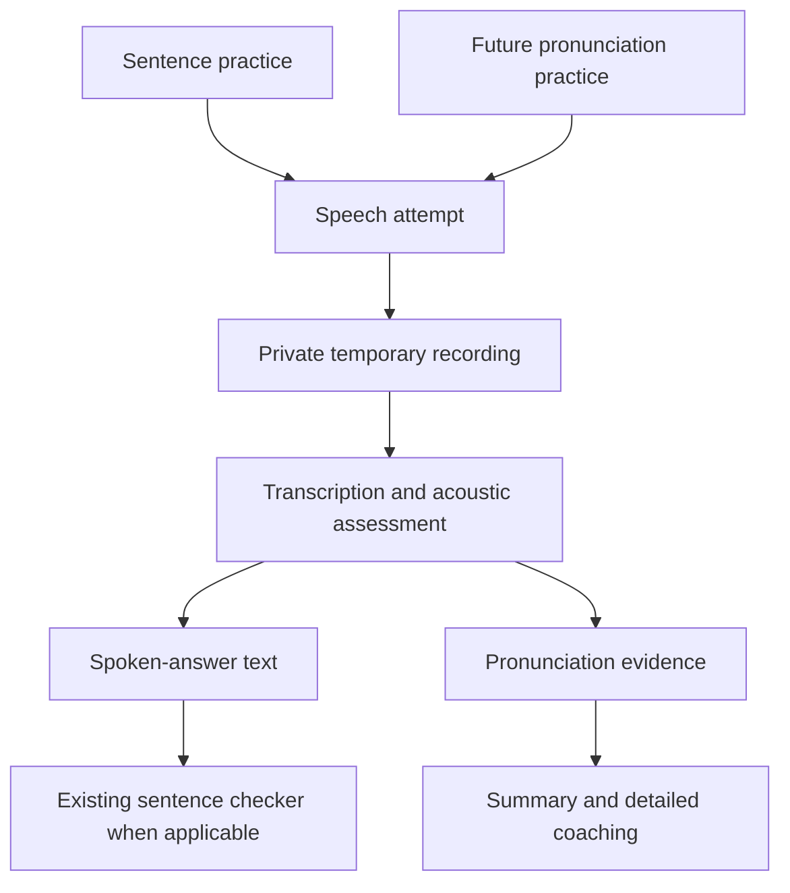

# Voice answers and pronunciation assessment

## Recommendation and evidence boundary

Build a reusable speech-assessment capability, with sentence practice as its
first consumer. Use a specialist pronunciation engine for acoustic assessment
and the existing sentence checker for meaning and grammar. This is a proposed
direction, not an accepted architecture decision or implementation plan.

For the user's Russia-registered business, investigate **SpeechSuper first** and
compare **Speechace** for English, French, and Spanish. Final selection depends
on commercial eligibility, retention terms, price, and a learner-audio benchmark.

This document preserves the initial conversation's desk research and read-only
codebase inspection. No paid API calls, audio benchmark, vendor outreach, or
application implementation were performed. Published support does not establish
assessment quality, and neither candidate's eligibility to contract with this
business has been confirmed. Saving this document did not refresh external facts.

## Confirmed requirements

- Launch on the web. Learners can submit text, voice, or both for translation
  exercises; the answer language is usually the language they are learning.
- Text and voice are expected to express the same answer, but may differ and
  should be evaluated separately.
- Prioritize understandability; accent coaching is optional.
- Show a simple summary and an expandable detailed pronunciation breakdown.
- Support languages where assessment works well, including interest in English,
  Mandarin Chinese, French, Spanish, and Turkish. Disable pronunciation
  assessment for unsupported languages rather than promising universal coverage.
- Offer balanced and top assessment options. Users spend prepaid credits on
  demand and decide whether an assessment is worth its displayed cost.
- Keep assessment reusable for a later standalone pronunciation-training flow.
- The business is registered in Russia; foreign processing is acceptable.
  Selectel is the preferred option if temporary object storage is needed in Russia.

Expected usage volume, maximum recording length, exact retention period, target
latency, tier prices, and final language list remain undecided.

## Separate speech recognition from pronunciation assessment

A transcript expresses what the recognizer thinks was said; it does not prove
that individual sounds were pronounced correctly. Transcript differences alone
cannot reliably distinguish recognition errors from pronunciation errors.

Keep three results separate:

| Result                  | Proposed responsibility                                                                      |
| ----------------------- | -------------------------------------------------------------------------------------------- |
| Written-answer feedback | Meaning, grammar, and vocabulary in the submitted text.                                      |
| Spoken-answer feedback  | Meaning, grammar, and vocabulary in recognized speech, with recognition uncertainty visible. |
| Pronunciation feedback  | Acoustic evidence for sounds, words, fluency, and supported tone/stress features.            |

A learner may write a correct translation but speak another tense, or pronounce
an incorrect translation clearly. Avoid collapsing these outcomes into one score.

The stored ideal translation is not the only valid spoken answer. For text plus
voice, the learner's text can supply intended wording while discrepancies remain
visible. For voice-only answers, evaluate an unscripted engine or transcription
followed by assessment against the recognized wording. Benchmark the latter
carefully: recognition may normalize a mistake or choose the wrong word, changing
what the pronunciation engine assesses. A corrected transcript should not silently
replace the original recognition evidence.

## Provider comparison

| Candidate                      | Documented capabilities                                                                                                      | Fit and limitations                                                                                      |
| ------------------------------ | ---------------------------------------------------------------------------------------------------------------------------- | -------------------------------------------------------------------------------------------------------- |
| SpeechSuper                    | Multilingual scripted assessment, English unscripted assessment, and Mandarin diagnostics.                                   | First multilingual candidate; verify language-specific APIs, retention, business eligibility, and quote. |
| Speechace                      | Pronunciation and fluency for English, French, and Spanish; sound-level feedback. Some additional features are English-only. | Useful comparison for these languages, but insufficient as the only multilingual provider.               |
| Azure Pronunciation Assessment | Broad assessment-language coverage including English, Mandarin, French, and Spanish; detail varies by locale.                | Technical benchmark; commercial eligibility requires confirmation for this business.                     |
| General audio models           | Audio understanding and transcription, potentially useful for coaching explanations.                                         | Experimental comparison track; sound-level diagnostic accuracy is unverified.                            |

Sources: [SpeechSuper documentation](https://docs.speechsuper.com/),
[Speechace capability matrix](https://api-docs.speechace.com/getting-started/supported-languages),
[Azure assessment language coverage](https://learn.microsoft.com/en-us/azure/ai-services/speech-service/language-support?tabs=pronunciation-assessment),
and [Gemini audio documentation](https://ai.google.dev/gemini-api/docs/audio).

### Language-specific findings

Mandarin needs explicit tone assessment. SpeechSuper's Mandarin API documents
tone diagnostics and initial/final sound feedback, making it a relevant candidate
for Chinese. [Mandarin assessment API](https://docs.speechsuper.com/Languages/Mandarin%20Chinese/sent.eval.promax.cn.md)

Turkish was absent from the pronunciation support lists inspected for Azure,
SpeechSuper, and Speechace. Initially leave it disabled unless a suitable engine
passes evaluation. This is a finding about the inspected shortlist, not a claim
that no Turkish assessment provider exists. General transcription support alone
should not enable pronunciation feedback.

Azure documents prosody assessment only for US English. Track transcription,
pronunciation, sound-level feedback, stress, and prosody as separate capabilities
per language/locale rather than one broad supported-language flag.
[Azure assessment documentation](https://learn.microsoft.com/en-us/azure/ai-services/speech-service/how-to-pronunciation-assessment)

### Commercial and geographic availability

OpenAI's inspected supported API country list excludes Russia. Microsoft's
published 2022 announcement suspended new sales in Russia; this historical
announcement is a reason to verify current eligibility, not a complete current
contractual determination. Do not choose either as a default dependency without
resolving access. [OpenAI country availability](https://developers.openai.com/api/docs/supported-countries),
[Microsoft sales announcement](https://blogs.microsoft.com/on-the-issues/2022/03/04/microsoft-suspends-russia-sales-ukraine-conflict/)

SpeechSuper and Speechace technical documentation does not establish that they
will contract with a Russian business. Confirm eligibility, payment arrangements,
processing region, retention, and data-use terms before a paid trial. No vendor
has been contacted as part of this research.

## Existing application and proposed integration

The existing sentence checker is text-only. The web submits an answer string;
the backend records an immutable input and processes checking asynchronously.
Attempts retain text feedback for meaning, grammar, vocabulary, and improvements.
See the [web session model](../../apps/web/src/fsd/features/sentence-training/model/sentence-session.ts),
[sentence contracts](../../packages/contracts/src/learning/sentences.ts), and
[sentence worker](../../apps/backend/src/modules/learning/application/sentence-worker-service.ts).

Existing admission already snapshots model selection and pricing, reserves
prepaid credits, and settles or releases the reservation. These patterns are
useful for speech attempts; new speech work needs its own typed capability and
job configuration rather than pretending to be a text-check model.
See [sentence admission](../../apps/backend/src/modules/learning/infrastructure/persistence/drizzle/drizzle-sentence-practice-store.ts)
and [job accounting](../../apps/backend/src/modules/learning/infrastructure/persistence/drizzle/sentence-job-accounting.ts).

The existing dictionary audio subsystem supplies TTS playback, not learner
recording assessment. Its private-storage and authorization patterns provide
useful precedent. [ADR-0020](../adr/0020-dictionary-pronunciation-audio.md) keeps
dictionary ownership and discourages premature generic media extraction;
[ADR-0027](../adr/0027-typed-sentence-work-and-shared-ai-accounting.md) constrains
sentence ownership and shared accounting. Neither ADR approves this new feature.

Proposed structure:

The reusable capability would accept a recording, answer language, optional
intended wording, and assessment configuration, then return pronunciation
evidence independently of translation correctness. Keep provider scores, model
versions, and capability availability explicit; scores from different providers
or languages should not be presumed equivalent.

## Quality tiers and cost

Treat these as benchmark hypotheses, not selected implementations:

- **Balanced:** one assessment engine, necessary transcription, concise coaching.
- **Top:** a demonstrably better engine or additional assessment that improves
  error detection, with richer supported diagnostics.

Both tiers should give useful pronunciation feedback. Extra explanation length
alone does not establish higher quality, and two models do not automatically
outperform one. Do not claim a premium-quality benefit before measuring it.

Show the credit cost or maximum charge before submission and pin the selected
configuration to the attempt. Reuse existing reservation/settlement patterns.
Define partial-failure billing, including successful text checking with failed
pronunciation assessment, before implementation.

At the research date, Speechace listed Pro at **$80/month with 10,000 included
15-second requests**, and Premium at **$125/month with 10,000 included 15-second
requests**. These are plan figures, not the app's complete cost per attempt.
SpeechSuper needs a quote for the chosen languages and engines.
[Speechace API pricing](https://www.speechace.com/api-plans/)

Full cost modeling must account for transcription, assessment, explanation,
request-duration billing, retries, subscription minimums, and storage/transfer.
Usage volume remains unknown; no monthly budget estimate or tier price is set.

## Recording storage and privacy

Selectel storage does not control an assessment provider's retention of its
copy. Speechace documents a default **90-day retention period**, with shorter
retention available contractually. [Speechace retention policy](https://api-docs.speechace.com/resources/data-retention)

Proposed starting policy: private, short-lived recordings, automatic deletion
after processing plus a limited retry window, and no permanent recording history
unless explicitly included in the product scope. Confirm provider retention and
training-use terms separately. Foreign processing is acceptable to the user;
this does not establish provider eligibility or legal compliance.

## Proposed evaluation before implementation

Start with English, Mandarin, French, and Spanish. An initial **30–50 short
recordings per language** can expose major weaknesses; it is not sufficient to
claim production-grade accuracy. Use recordings collected with appropriate
permission and have qualified speakers or teachers independently label issues.

Include clear speech with acceptable accents; intentional sound, stress, and
tone mistakes; clearly pronounced incorrect translations; valid alternative
translations; text/voice disagreements; hesitation; noise; silence; and clipped
recordings.

Compare false accusations, missed meaningful errors, correction usefulness,
repeatability, latency, and full cost. For understandability-first learning,
penalizing an acceptable accent is a serious quality failure. Agree on acceptance
thresholds before evaluating, rather than fitting them to whichever provider wins.

Test whether detailed feedback is supported by acoustic evidence. An explanation
model can turn detected issues into helpful instructions, but should not invent
phonetic diagnoses from a transcript alone. Preserve recognition uncertainty and
an inconclusive/retry result rather than converting poor audio into a failing score.

## Open decisions and next research steps

1. Confirm candidate eligibility, payment, retention, data use, and processing
   locations for the Russia-registered business.
2. Obtain per-language/engine quotes and clarify scripted versus unscripted
   support; determine which languages merit a benchmark.
3. Define recording limits, latency expectations, partial-result billing, and
   exact temporary storage/deletion policy.
4. Run the consented learner-recording comparison and establish language-specific
   quality thresholds and usable diagnostic detail.
5. Select balanced/top configurations only where evidence supports the distinction.
6. Use the findings to scope separately authorized feature delivery, including
   contracts, persistence, security, accounting, and future standalone reuse.

No provider winner, production language matrix, accepted architecture decision,
or implementation completion is claimed by this survey.
